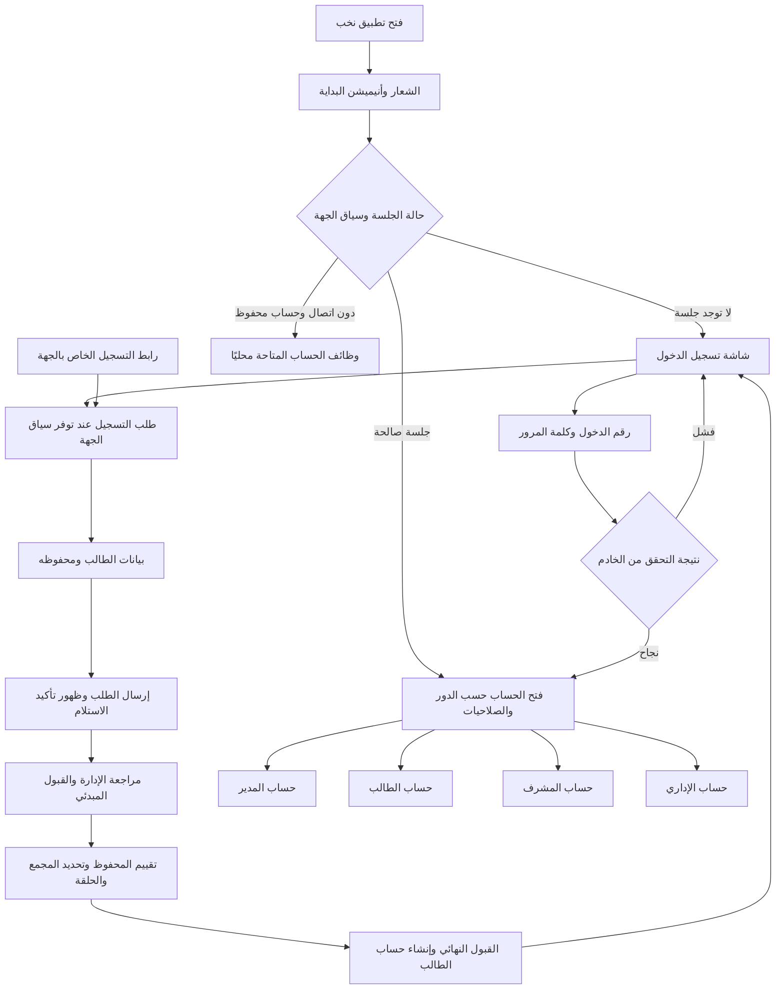

# خطة تحويل نخب إلى تطبيق نيتف

تغطي الخطة رحلة نخب كاملة على Android وiOS، من فتح التطبيق وأنيميشن الدخول وطلب التسجيل إلى حسابات المدير والطالب والمشرف والإداري، ثم المصحف والتسميع والمكالمات والإشعارات والعمل دون إنترنت. الهدف نقل الوظائف الحالية إلى واجهات نيتف مع الحفاظ على البيانات وقواعد التقييم والصلاحيات وهوية نخب.

الحالة: بدأ تنفيذ التحويل محليًا في 14 أكتوبر 2026 بأمر المستخدم. يجري تثبيت W00 وتجهيز أساس التجربة بصورة مستقلة، ويحتاج النشر تصريحًا مستقلًا.

## تجهيز نسخة TestFlight مستقلة — 16 أكتوبر 2026

طلب المستخدم تطبيق Expo تجريبيًا مستقلًا وفرع GitHub وبيانات اختبار منفصلة مع حفظ النسخة القديمة ومراجعها. [سجل التجربة](native-conversion/native-testflight-preview.md) يوثق API المعزول و35 تحقق HTTPS ومنع تكرار التهيئة. نجح البناء الموقّع17 وتصدير IPA ورفعه، ثم أصبحت0.1.0(17) بحالة Testing في مجموعة داخلية بحساب صاحب التطبيق وحده Invited. أُغلقت W13-01 بقائمة التوقيع والحساب والإصدار المتحقق منها؛ W13-03 verify حتى التشغيل الفعلي على iPhone. الإجمالي65/196 والمتبقي131. لا يثبت هذا اكتمال المطابقة أو اعتماديات W12 أو ترحيل بيانات النسخة القديمة.

## حالات الخطوات وطريقة وضع done

هذا هو ملف متابعة التحويل. الحالة الحالية: **65 من 196 خطوة وصلت إلى done**، وبقي 131. تشمل الأساس والدخول وبعض التسجيل، والقبول والإدارة والخطط ومساحة الطالب والتحضير والجلسات والتعويض وإعداد السرد والاجتياز والتقارير، ومنتجات المتجر وطلباته وإعداداته ومتجر الطالب وشراءه المحلي المتاح، وإدارة الأخبار وإرسال الإشعارات وسجلها، ومكونات الأساس W02-03 إلى W02-06 بدليل متصفح ومحاكي محدد النطاق. التفاصيل والشواهد في سجل الأدلة؛ بقية الحسابات والتحويل الكامل ما زالت مفتوحة.

تصحيح 15 أكتوبر 2026: طلب المستخدم التصميم السابق نفسه، بما فيه السايدبار والألوان والنهاري والليلي. بعد إغلاق W02-06 سابقًا، أُغلقت الآن W02-03 و W02-04 و W02-05 بمعايير مكونات الأساس المشتركة، فأصبح الإجمالي 64 والمتبقي 132. لا يعني ذلك مطابقة جميع الصفحات حرفيًا. التقرير الأحدث [الطالب والتقويم والخط](native-conversion/native-student-parity.md)، و[ملخصه](../mobile/evidence/student-parity-validation.json)، و[تدقيق السلامة](../outputs/native-conversion/student-artifact-integrity.json). تقارير المراحل السابقة تخص مصادرها وتواريخها ولا تُحمل على مصدر تغيّر.

| الحالة | معناها |
|---|---|
| `todo` | لم يبدأ تنفيذ الخطوة |
| `doing` | التنفيذ جارٍ |
| `verify` | التنفيذ جاهز ويحتاج التحقق المطلوب |
| `blocked` | يوجد عائق محدد مسجل مع الخطوة والإجراء اللازم لحله |
| `done` | انتهى التنفيذ واجتاز التحقق، وسُجل دليل ذلك |

يُكتب `done` في عمود الحالة أمام الخطوة بعد استيفاء القواعد التالية:

1. تنفيذ المطلوب كاملًا، بما فيه حالات التحميل والفراغ والخطأ والتعطيل والرجوع عندما تنطبق.
2. اجتياز معيار التحقق المكتوب أمام الخطوة، وفحص النجاح والفشل ومنع الوصول غير المصرح للوظائف التي تتعلق بالدخول والصلاحيات والبيانات.
3. توثيق رقم الخطوة والملفات أو الناتج وأمر الفحص أو سيناريوهاته والنتيجة وتاريخ التحقق في سجل الأدلة آخر الملف.
4. تحديد نطاق الدليل بوضوح: قواعد مشتركة، API محلي، متصفح، محاكي، Android فعلي أو iPhone فعلي. خطوة تتطلب الجهازين تبقى `verify` حتى يتوفر دليلهما.
5. مراجعة فرق الملفات والتأكد من حماية تغييرات المستخدم والبيانات وعدم وجود خطأ معروف يمنع قبول الخطوة.
6. تحديث الحالة إلى `done` وعدد الخطوات المنجزة في جدول المرحلة وفي العدد الإجمالي في هذا الملف.

لا توضع `done` لمجرد كتابة الكود أو ظهور الشاشة أو نجاح بناء لا يثبت السلوك. تعذر فحص لازم يبقي الحالة `verify` أو `blocked` مع السبب، ولا يحول الخطوة إلى منجزة. لا تُحذف خطوة أو يُخفف معيار قبولها لإخفاء فشل.

أُغلقت [الإحصائيات والتقارير W06-24 إلى W06-28 وفصل المنح W09-03](native-conversion/native-reports.md) بعد149 تحققHTTP/SQL و438 اختبار تطبيق والأنواع وLint وHermes، و38 مجموعةChromium ورحلةAndroid جديدة37 تحققًا، ثم التنظيف وإيقافMySQL المملوك. الإجمالي53 من196 وبقي143؛W06 منجز24 من41 وW09 منجز4 من7. تحفظ الأدلة حدود304 والحذف غير المؤكد والمنح وفجوات النقاط القديمة، ولا تغلق الأجهزة الفعلية أوW10.

إذا ظهر خلل في خطوة منجزة أو تغيّر تنفيذها بما يؤثر في الدليل، تعاد إلى `doing` أو `verify` ويحدث العدد، ثم يسجل التحقق الجديد قبل إعادتها إلى `done`.

[المتجر والشراء المحلي](native-conversion/native-store.md): أُغلقت W06-30 و W06-31 و W06-32 و W07-13 و W07-14 فقط؛ الإجمالي **58 من 196** والمتبقي 138، و W06 منجز 27 من 41 و W07 منجز 3 من 18. اجتازت 152 تحققًا (144 تحقق استجابة HTTP و 8 SQL/محلية) و 557 اختبارًا والأنواع و Lint و Hermes. المتصفح السادس اجتاز 38 مجموعة في 6 تنويعات و 83 صورة و 802 طلبًا، مع 27 طلب Node و 3 تهيئة منفصلة؛ Android السادس اجتاز 29 فحصًا و 20 صورة و 207 طلبات مع 10 تهيئة. تطابقت 333 بصمة في كل رحلة، منها 332 مشتركة. APK الجديد اجتاز مع 195 بصمة وتنظيف stage؛ MySQL3310 المملوك أُغلق بعد صفر جلسات واتصالات أخرى في 42 قاعدة محفوظة. المخزون 43 ملفًا: 29 جديدًا و 14 محدثة، و 5147 مسارًا محميًا دون اختلاف. verify التطبيق ما زال يفشل عند audit بخمس إصابات عالية و Doctor الحالي 20/21، و verify الجذر عند 7 أخطاء Lint قائمة؛ 782 اختبارًا والتدقيق صفر والبناء 15.85 ثانية اجتازت مستقلة. لا إغلاق W10 أو دخول بارد دون اتصال أو أجهزة فعلية أو iPhone أو API36.

أرقام الخطوات ثابتة مثل `W03-02`؛ أي وظيفة جديدة تُضاف برقم جديد في مرحلتها دون إعادة ترقيم المنجز. يراجع W00 الحصر النهائي، ويضيف أي عملية حالية لا تغطيها الخطوات أدناه قبل بدء نقل شاشتها.

[الأخبار والإشعارات](native-conversion/native-communications.md): أُغلقت W06-33 وW06-34 بعد 638 اختبارًا والأنواع وLint وHermes، و154 تحقق HTTP/SQL، و24 مجموعة متصفح في6 تنويعات و53 صورة، ورحلة Android جديدة كاملة اجتازت27 فحصًا و21 صورة و122 طلبًا مع20 تهيئة منفصلة. [تدقيق الشواهد الثلاثة](../outputs/native-conversion/communications-harness-integrity.json) يثبت مصدر مرحلة الأخبار والإشعارات وصورها وتنظيفها قبل تصحيح التصميم؛ الإجمالي60/196 والمتبقي136، وW06 منجز29/41. MySQL3310 المملوك أُغلق مع حفظ263 قاعدة؛ تدقيق60 قاعدة موثقة أثبت صفر جلسات واتصالات أخرى، وبقيت203 قواعد أقدم دون قراءة جداولها و3312/PID11980 دون تغيير. صندوق الحساب يظل W07-16 verify لغياب destination من العقد، وW10 وpush والأجهزة الفعلية مفتوحة. verify التطبيق الكامل يفشل عند5 ثغرات عالية، وDoctor20/21، وverify الجذر عند7 أخطاء Lint السابقة؛ لا تُوصف السلسلتان بالنجاح.

## شاهد تصحيح التصميم الأول والمعاينة — 15 أكتوبر 2026

في التصحيح الأول أُعيدت ألوان الموقع الأصلية دون تغيير قيمها، وخطوطه وأيقوناته وشعاره، والسايدبار والهيدر وتبويبات المستخدمين، وحفظ المظهر وإبقاء الدخول فاتحًا، وتخطيط عدد من الصفحات ودوائر الإحصائيات. لم يضف ذلك الشاهد done؛ كان العدد حينها60/196 والمتبقي136. لا تُقبل إعادة تصميم جديدة أثناء التحويل. حالة المتابعة الأحدث أدناه.

تحقق تلك النسخة:638 اختبار تطبيق والأنواع وLint وتصديرHermes للمنصتين، و782 اختبار جذر وبناء الموقع اجتازت؛ المتصفح اجتاز61 فحصًا و42 PNG فريدة على320/390/1440، وصفر أخطاءJavaScript، و957 بصمة مصدر/ناتج ثابتة قبل/بعد/حالية. شمل حفظ المظهر وفشل التخزين والتركيز والقائمة والصلاحيات و401/403 وحفظ إشعار فعلي ومنع النقر المزدوج وتكرارUUID. هذا لا يثبت المصدر المعدل في المتابعة أو المطابقة الحرفية لجميع الصفحات أو أي جهاز فعلي. [شواهده وحدوده](native-conversion/native-design-parity.md).

full verify التطبيق يفشل عند5 ثغرات Expo عالية، وfull verify الجذر عند7 أخطاءLint السابقة. Doctor20/21 عائق تاريخي لم يُعد في هذه المرحلة. MySQL3310 أُعيد تشغيله بملكية موثقة وdatadir محفوظ دون تهيئة؛ المعاينة5187 ومرجع الموقع5188 يعملان محليًا، و265 قاعدة محفوظة و6 جلسات معاينة عند التدقيق، لا صفر جلسات عام. راجع runtime الأحدث ولا توقف خدمة مشروع آخر. المصدر المحمي743/769 دون اختلاف، والتعديلات المصرح بها26 مع13 مصدرًا جديدًا؛ حُفظت تغييرات المستخدم والحذف القائم. لا نشر أوSQL إنتاجي أوcommit/push، ولا إعادة اعتماد APK أو رحلة Android سابقة على مصدر الواجهة الجديد.

## سجل سابق: مكونات الأساس والبوابات — 15 أكتوبر 2026

أُغلقت **W02-06 فقط**: القوائم والبطاقات والتبويبات وحالات التحميل والفراغ والفشل وإعادة المحاولة. الدليل 97 فحصًا و 39 صورة في 320/390/1440 بالنهاري والليلي، ومنها 18 حالة بطاقة بصف واحد و 24 صفًا دون تداخل، وبطاقة تفاعلية حقيقية دون كتابة بيانات. تدعمها 250 مقارنة بوابات و 182 صورة، و 230 فحصًا للتركيز والنوافذ و 3 صور؛ الإجمالي 577 تحقق متصفح و 224 لقطة. أصلحت المتابعة كذلك تنسيق التسجيل والتحضير والسرد ومساحتي الطالب والمشرف، و Escape المتداخل والضغط المستمر وفقد التركيز، وتداخل إغلاق الدرج وفتح النموذج. لا يُغلق بذلك تطابق كل الصفحات أو W02 كلها.

التحقق النهائي للمصدر:638 اختبار تطبيق والأنواع و Lint و Hermes للمنصتين، و 782 اختبار جذر. بقي audit التطبيق عند 5 إصابات عالية، و verify الجذر عند 7 أخطاء Lint السابقة؛ Doctor20/21 آخر نتيجة موثقة ولم يُعد. فُصل تشغيل التجميع إلى عاملين واختبارات الجذر إلى تزامن 2 لتقليل تنافس موارد المضيف دون تعطيل فحص.

تظل **W02-03 و W02-04 في verify**: أُثبتت الألوان والخط و RTL والنصوص المختلطة و CSS zoom والتركيز والتعطيل والتحميل في المتصفح، لكن لم يثبت تكبير خط النظام أو لوحة المفاتيح النيتف. [حارس Android النهائي](../outputs/native-conversion/android-foundation/2026-10-15T16-20-55-295Z-865f5d21db/validation.json) أعاد blocked-host-resources عند 3673.855MiB أقل 4096MiB ؛ لم يبدأ محاكيًا أو Metro أو fixture ، ولا طلبات API أو حسابات، والتنظيف وثبات المصدر اجتازا. هذا غياب تحقق نيتف، وليس فشل تطبيق أو دليل جهاز. [جامع الشواهد](../outputs/native-conversion/foundation-artifact-integrity.json) يصرح بنطاق partial عند بقاء هذا العائق.

الإجمالي 61/196 والمتبقي 135 ، و W02 منجز 4/13. W00-03 و W02-05 و W02-07 و W06-01 ما زالت مفتوحة. [الملفات والحدود والمحاولات وحماية المستخدم](native-conversion/native-foundation-parity.md) و[ملخص المتابعة](../mobile/evidence/foundation-validation.json). المعاينتان 5187/5188 و MySQL3310 المملوك باقية؛ لا نشر أو SQL إنتاجي أو commit/push.

## متابعة الطالب والتقويم والخط — 15 أكتوبر 2026

أُغلقت **W02-03 و W02-04 و W02-05** ضمن معايير مكونات الأساس: الخط والألوان والمظهران و RTL والنصوص الطويلة والمختلطة وتكبير خط النظام؛ الأزرار والحقول وكلمة المرور والتركيز والتعطيل والتحميل ولوحة الهاتف ومنع تكرار الدخول؛ والاختيارات والتقويم والنوافذ والتأكيد والفراغ والخطأ وإعادة المحاولة والرجوع مع حفظ المسودة.

الدليل الحالي:218 فحص Chromium و 97 صورة على 320/390/1440 في الثيمين، ثم رحلة Android API35 جديدة كاملة: 27 فحصًا و 25 صورة و 112 طلب HTTP مع 66 طلب تهيئة وتنظيف منفصل. تطابقت 1033 بصمة في المتصفح و 846 في المحاكي قبل/بعد/حاليًا، وصورها وتنظيف حساباتها وجلساتها اجتازت.655 اختبار تطبيق والأنواع و Lint و Hermes و web، و 782 اختبار جذر اجتازت. [التقرير والملفات والحدود](native-conversion/native-student-parity.md)، و[جامع الشواهد](../outputs/native-conversion/student-artifact-integrity.json).

**المطابقة الحرفية و W02-07 باقيتان مفتوحتين:** وزن التبويب 850 في الأصل مقابل 800 في Expo، وإطار وتمويه جلسات الكمبيوتر؛ وحفظ المساحة بعد إعادة تركيب SessionGate. تغيير font_scale في الرحلة أعاد المسار إلى الإحصائيات؛ سُجل ذلك كفجوة، ثم أُعيد التنقل الحقيقي لفحص الخط دون ادعاء استعادة المسار. لا دليل جهاز فعلي أو iPhone أو APK جديد أوبناء iOS أصلي، ومقاطعة الافتتاح الحية بقيت not-exercised. العوائق العامة:5 ثغرات عالية في أدوات Expo و 7 أخطاء Lint سابقة بالجذر؛Doctor20/21 نتيجة سابقة لم تُعد. لا يوصف verify الكامل بالنجاح.

الإجمالي **64/196 والمتبقي 132**؛W02=7/13. شواهد المحاولات الفاشلة محفوظة دون نقل نجاح، والمصدر الأصلي والخادم و shared وسياسة تنفيذ القرآن وتغييرات المستخدم والحذفان محفوظة. لا نشر أو SQL إنتاجي أو commit/push.

## الأساس التقني وحدود التحويل

التطبيق الحالي يستخدم React وCapacitor، مع خادم Node.js وقاعدة MySQL ومنطق JavaScript مشترك. المسار المقترح هو React Native مع Expo ونسخ تطوير فعلية للأجهزة. تُبنى الواجهات من [مكونات React Native](https://reactnative.dev/docs/components-and-apis)، ونثبت إصدارات متوافقة مع المصحف وLiveKit والتخزين المشفّر خلال التجربة الأولى.

| الطبقة | ما سيحدث لها |
|---|---|
| الموقع الحالي | يستمر العمل به أثناء بناء تطبيق الجوال ونقل الوظائف تدريجيًا |
| الخادم وقاعدة MySQL | نعيد استخدامهما؛ أي تعديل لازم لعقد API يكون محدودًا ومتوافقًا مع الموقع |
| قواعد الدرجات والخطط والتعويض والصلاحيات | نشارك المنطق الموجود في `shared/` ونختبر تطابق النتائج |
| واجهات الجوال | نعيد بناء العرض والتنقل والحقول والنوافذ بمكونات نيتف |
| تكاملات Capacitor | نستبدلها بتكاملات تناسب التطبيق الجديد، مع معالجة بيانات النسخة السابقة |
| ملفات Android وiOS الحالية | تبقى مرجعًا للهوية والسلوك المطلوب؛ إعداد النسخة الجديدة وتوقيعها يعتمدان على بيانات متحقق منها |

يكون تطبيق الجوال داخل `mobile/` في مستودع نخب نفسه، مع بقاء `src/` للموقع و`server/` للخادم و`shared/` للقواعد المشتركة. لا تتطلب الخطة نقل المشروع كله إلى بنية جديدة. تتحدد المسارات الداخلية النهائية بعد التجربة التقنية.

نحتفظ بالتصميم واللغة والألوان الحالية كنقطة بداية. تحسينات التنقل اللازمة للجوال تُعرض للمراجعة مع الشاشات، وأي تغيير تجاري في التسجيل أو التقييم أو الصلاحيات يوثّق ويعتمد بصورة مستقلة.

الأدوار المفعلة في الدخول الحالي هي المدير والطالب والمشرف والإداري. دور المقرئ محذوف، ومسار مالك المنصة ليس مدخلًا فعالًا في التطبيق الحالي؛ لا يُعاد تفعيل أي منهما ضمن هذا التحويل. بيانات ولي الأمر في طلب التسجيل لا تعني وجود حساب مستقل لولي الأمر.

## رحلة المستخدم من فتح التطبيق إلى الحساب

الطلب العام لا ينشئ حساب مدير أو مشرف أو إداري. إنشاء هذه الحسابات وإدارة وصولها يظلان ضمن الصلاحيات الحالية. طلب التسجيل يمر بمراجعة الإدارة قبل إنشاء حساب الطالب، والرفض يحافظ على أثره الحالي مع تأكيد واضح للعملية.

## مراحل التنفيذ والمدة

التقديرات تشمل عملي في كتابة الكود والربط والمراجعة والاختبارات، مع مراجعة صاحب المشروع للشاشات وتوفر Android وiPhone للاختبار. تفترض عملًا يوميًا منتظمًا ومتطلبات مستقرة، ولا تشمل انتظار حسابات المتاجر أو شهادات التوقيع أو مراجعة المتاجر. لا تمثل قياسًا لتوفير الوقت بواسطة الذكاء الاصطناعي.

| المرحلة | النتيجة المطلوبة | أيام العمل المتوقعة | الاعتماد | الحالة | done |
|---|---|---|---|---|---|
| W00 | تثبيت الوظائف والعقود ومرجع التصميم والتحقق | 2 إلى 3 | بداية التنفيذ | doing | 5 من 8 |
| W01 | تجربة مصحف وتخزين ومكالمة على الجهازين | 4 إلى 6 | W00 | doing | 0 من 7 |
| W02 | أساس التطبيق والمكونات والخدمات المشتركة | 3 إلى 5 | W01 | doing | 7 من 13 |
| W03 | فتح التطبيق والأنيميشن واستعادة الجلسة | 2 إلى 3 | W02 | doing | 0 من 9 |
| W04 | تسجيل الدخول والخروج وتوجيه الأدوار | 3 إلى 4 | W03 | doing | 5 من 14 |
| W05 | طلب التسجيل ومراجعته حتى القبول النهائي | 4 إلى 6 | W04 | doing | 8 من 15 |
| W06 | حساب المدير ووظائف الإدارة | 6 إلى 9 | W05 | doing | 29 من 41 |
| W07 | حساب الطالب ووظائفه والمصحف | 5 إلى 7 | W06 | doing | 3 من 18 |
| W08 | حساب المشرف والتسميع والتصحيح | 6 إلى 9 | W07 | doing | 3 من 16 |
| W09 | حساب الإداري بحسب صلاحياته | 2 إلى 3 | W08 | doing | 4 من 7 |
| W10 | اكتمال العمل المحلي والمزامنة وترحيل البيانات | 3 إلى 5 | W07 إلى W09 | todo | 0 من 13 |
| W11 | اكتمال المكالمات والإشعارات وتكاملات الجهاز | 4 إلى 6 | W08 وW10 | todo | 0 من 15 |
| W12 | اختبار الرحلات كاملة والأداء والوصول | 4 إلى 7 | W09 إلى W11 | todo | 0 من 12 |
| W13 | تجهيز إصدار تجريبي وخطة الانتقال والتراجع | 2 إلى 3 | W12 | doing | 1 من 8 |

المجموع 50 إلى 76 يوم عمل، أي نحو 10 إلى 16 أسبوعًا عند خمسة أيام عمل أسبوعيًا. تجربة W01 جزء من هذا المجموع. نعيد تقدير المراحل المتبقية بعد التجربة، لأن تحميل خطوط المصحف وترحيل التخزين المشفّر هما أكبر مصدرين لعدم اليقين.

## W00 تثبيت الوظائف والعقود

| الحالة | رقم الخطوة | المطلوب تنفيذه | التحقق قبل done |
|---|---|---|---|
| done | W00-01 | حصر الشاشات ومسارات الموقع والتطبيق الحالية. | مطابقة الحصر مع المسارات والمكونات الفعالة. |
| done | W00-02 | حصر عمليات القراءة والحفظ والتعديل والحذف والاستيراد والتصدير في كل شاشة. | ربط كل عملية بخطوة تحويل وعدم الاكتفاء بعناوين الأقسام. |
| verify | W00-03 | تثبيت مرجع التصميم والشعار والألوان والثيمين والأنيميشن. | صور للشاشات الحالية على مقاس جوال وسطح مكتب. |
| done | W00-04 | إعداد مصفوفة أدوار المدير والطالب والمشرف والإداري. | مطابقة الأقسام والعمليات المسموحة مع الخادم. |
| verify | W00-05 | توثيق عقود الدخول والتسجيل والدرجات والمزامنة والمكالمات. | طلبات واستجابات نجاح وفشل فعلية من بيئة اختبار. |
| done | W00-06 | حصر بيانات الحساب والجهة والجلسة ومفاتيح التشفير والتخزين. | تحديد مصدر كل قيمة وحدود مشاركتها بين الحسابات. |
| done | W00-07 | تجهيز بيانات اختبار منفصلة لكل دور وحالة. | حسابات ومجموعة بيانات صالحة ومعزولة دون أسرار في التقرير. |
| blocked | W00-08 | قياس فتح التطبيق والمصحف والتسميع وتحديد معيار الأداء. | قياسات مرجعية وتحديد الأجهزة وحدود القبول المتفق عليها. |

معيار إغلاق المرحلة: لكل وظيفة حالية خطوة قابلة للتتبع ومرجع وصلاحية وعقد تحقق، وتشمل النسخة المرجعية تعديلات المصحف بعد استقرارها.

## W01 تجربة الأجزاء الصعبة

تُنفذ التجربة داخل تطبيق الجوال الجديد، وتصبح أساسًا للمراحل التالية. تستعمل نسخة تطوير فعلية؛ LiveKit لا يعمل داخل Expo Go وفق [توثيق LiveKit](https://docs.livekit.io/transport/sdk-platforms/expo/). نجهّز خطوطًا مناسبة للجهازين وفق [توثيق خطوط Expo](https://docs.expo.dev/develop/user-interface/fonts/)، مع فحص مصدرها وترخيصها.

| الحالة | رقم الخطوة | المطلوب تنفيذه | التحقق قبل done |
|---|---|---|---|
| verify | W01-01 | إنشاء نسخة تطوير أولية تعمل على Android وiPhone. | فتح النسخة على الجهازين وإثبات هوية نخب. |
| verify | W01-02 | عرض صفحات مصحف متنوعة وتحميل الخطوط المناسبة. | صحة التشكيل والأسطر والصفحتين الأولى والثانية على الجهازين. |
| doing | W01-03 | تجربة تقليب RTL وتحديد الكلمات والتظليل بين الأسطر. | تحديد نطاق معروف ومقارنته بالنص وحدود الكلمات. |
| verify | W01-04 | حفظ مسودة وجلسة تسميع في تخزين مشفّر. | استعادتهما بعد إغلاق التطبيق وإعادة فتحه. |
| todo | W01-05 | مزامنة الجلسة التجريبية مع الخادم. | وصول النتيجة مرة واحدة رغم إعادة إرسال العملية. |
| doing | W01-06 | تجربة غرفة LiveKit بالصوت والكاميرا وإعادة الاتصال. | جهازان يتبادلان الصوت والفيديو بعد انقطاع قصير. |
| todo | W01-07 | تجربة نقل جلسة وبيانات معلقة من نسخة Capacitor. | إثبات مسار آمن للقراءة أو النقل ومفاتيح التشفير. |

معيار إغلاق المرحلة: المصحف والتخزين والمكالمة والترحيل لها طريقة تنفيذ مثبتة على Android وiPhone، ويُحدّث تقدير الوقت إذا غيّرت التجربة طريقة الحل.

## W02 أساس التطبيق والمكونات المشتركة

| الحالة | رقم الخطوة | المطلوب تنفيذه | التحقق قبل done |
|---|---|---|---|
| doing | W02-01 | إعداد تطبيق الجوال في mobile وتثبيت الإصدارات المتوافقة. | بناء وتشغيل نسختي التطوير دون تغيير مدير حزم الموقع. |
| done | W02-02 | إعداد هوية nukhab ومعرّف sa.nukhab.app والموارد. | مطابقة الاسم والشعار والمعرّف مع المشروع الحالي. |
| done | W02-03 | إعداد الخط العربي والألوان والثيمين و RTL. | فحص نصوص طويلة وأرقام واتجاه مختلط وتكبير الخط. |
| done | W02-04 | بناء الأزرار والحقول وكلمة المرور. | فحص اللمس والتركيز والتعطيل والتحميل ولوحة المفاتيح. |
| done | W02-05 | بناء الاختيارات والتواريخ والنوافذ والتنبيهات. | فحص الفتح والإغلاق والرجوع وحالات الفراغ والخطأ. |
| done | W02-06 | بناء القوائم والبطاقات والتبويبات وحالات تحميل الشاشة. | عرض بيانات قليلة وكثيرة دون تداخل أو فقد التفاعل. |
| doing | W02-07 | إعداد التنقل والمساحات الآمنة والرجوع واستعادة الشاشة. | الرجوع من شاشة ونافذة دون إغلاق التطبيق خطأ. |
| doing | W02-08 | إعداد فتح الروابط ووجهات الإشعارات. | الاحتفاظ بالوجهة أثناء فتح التطبيق والدخول. |
| done | W02-09 | فصل عميل API والجلسة وسياق الجهة ومعالجة الأخطاء. | فحص 401 و403 وأخطاء التحقق والتعارض وانقطاع الشبكة. |
| doing | W02-10 | فصل التخزين الآمن والمحلي وأحداث التطبيق وحالة الاتصال. | عدم اعتماد الخدمات الجديدة على DOM أو تخزين المتصفح. |
| done | W02-11 | مشاركة قواعد shared وعزل الطلبات حسب الحساب والجهة. | اختبارات تطابق القواعد وتجاهل نتائج الحساب السابق. |
| blocked | W02-12 | إعداد Lint وفحص الأنواع والاختبارات والبناء للجوال. | أوامر تحقق واضحة تعمل دون تعطيل تحقق الموقع والخادم. |
| todo | W02-13 | نقل الصفحات المشتركة للخصوصية والشروط والدعم والتنزيل بحسب مساراتها الحالية. | فتح الروابط من الحسابات والدخول مع رجوع صحيح ومحتوى مطابق. |

معيار إغلاق المرحلة: الهوية والمكونات والتنقل وطبقات البيانات جاهزة للاستخدام، والجوال والموقع يحتفظان بقواعد مشتركة سليمة.

## W03 فتح التطبيق وأنيميشن البداية

المرجع الأولي هو الحركة الحالية ومدتها ثانيتان، مع الشعار الأبيض والخلفية الخضراء والزخارف السفلية.

| الحالة | رقم الخطوة | المطلوب تنفيذه | التحقق قبل done |
|---|---|---|---|
| doing | W03-01 | إعداد شاشة الإطلاق الأصلية والخلفية والشعار. | عدم ظهور شاشة بيضاء قبل بدء الواجهة. |
| doing | W03-02 | نقل حركة ظهور الشعار والنص والزخارف. | مراجعة الحركة على Android وiPhone مقابل المرجع. |
| doing | W03-03 | نقل الانتقال من الأنيميشن إلى شاشة الدخول أو الحساب. | انتقال متصل دون قفزة في الشعار أو الخلفية. |
| doing | W03-04 | تهيئة الخطوط والموارد اللازمة قبل إظهارها. | فتح بارد متكرر دون تبدل خط أو صورة متأخرة. |
| verify | W03-05 | استعادة الجلسة أثناء البداية والتوجيه للحساب. | فتح حساب كل دور مباشرة عند وجود جلسة صالحة. |
| doing | W03-06 | تطبيق تقليل الحركة وعدم تكرار الحركة في كل تنقل. | فحص إعداد الجهاز والعودة من الخلفية. |
| verify | W03-07 | ضبط تفاعل حقول الدخول أثناء الانتقال. | إتاحة الحقول فور انتهاء الحركة ومنع النقر المتداخل. |
| verify | W03-08 | معالجة انتظار الجلسة وفشل الاتصال والفتح دون إنترنت. | إظهار الحالة المناسبة دون انتظار لا ينتهي. |
| doing | W03-09 | الحفاظ على رابط التسجيل أو وجهة الإشعار أثناء البداية. | فتح الوجهة الصحيحة بعد الأنيميشن والتحقق من الجلسة. |

معيار إغلاق المرحلة: الفتح البارد والعودة من الخلفية وفتح الروابط تعمل على الجهازين دون وميض أو تعليق أو تكرار غير مقصود للأنيميشن.

## W04 الدخول والخروج وتوجيه الحسابات

| الحالة | رقم الخطوة | المطلوب تنفيذه | التحقق قبل done |
|---|---|---|---|
| done | W04-01 | نقل حقل رقم الدخول والأرقام العربية والإنجليزية. | مطابقة قواعد الإدخال ومنع القيم غير الصحيحة. |
| verify | W04-02 | نقل كلمة المرور وإظهارها وإخفائها وإرسال لوحة المفاتيح. | إرسال واحد مع عمل إظهار الرمز والتركيز والرجوع. |
| done | W04-03 | ربط الدخول وحالة التحميل ومنع النقر المتكرر. | تسجيل ناجح دون إنشاء طلبات متزامنة غير مقصودة. |
| verify | W04-04 | حفظ الجلسة بأمان وربطها بالحساب وسياق الجهة. | استعادة الجلسة بعد الإغلاق وعدم خلط جهة أخرى. |
| done | W04-05 | نقل مساعدة نسيان كلمة المرور الحالية. | عرض التواصل مع الإدارة كما في السلوك الحالي. |
| doing | W04-06 | توجيه المدير إلى حساب الإدارة. | ظهور الوظائف المسموحة بعد جلسة متحقق منها. |
| done | W04-07 | توجيه الطالب إلى رئيسيته. | عرض بيانات الطالب المسجل فقط. |
| doing | W04-08 | توجيه المشرف حسب أقسامه ومنحه. | تطابق التنقل مع الصلاحيات والإعدادات الحالية. |
| done | W04-09 | توجيه الإداري حسب الصلاحيات الممنوحة. | فحص إداري بلا صلاحيات وبصلاحية واحدة. |
| verify | W04-10 | معالجة خطأ كلمة المرور والحساب المعطل وحدود المحاولات. | اختبارات رفض فعلية ورسائل مناسبة دون كشف تفاصيل داخلية. |
| verify | W04-11 | معالجة انتهاء الجلسة وسحب الصلاحية وانقطاع الشبكة. | سلوك واضح يحافظ على الفصل بين البيانات المحلية والوصول للخادم. |
| doing | W04-12 | تنفيذ الخروج وتبديل الحساب وإيقاف الاشتراكات. | إلغاء الطلبات والمكالمة وعدم عرض أو إرسال بيانات الحساب السابق. |
| doing | W04-13 | منع الدخول المحمي عبر الرابط والإشعار والرجوع. | فحص مستخدم خارج الجلسة ودور غير مخوّل. |
| todo | W04-14 | نقل مسار طلب حذف الحساب والروابط النظامية لكل دور وفق إتاحتها الحالية. | الطلب والإلغاء والإذن والعودة تعمل للأنواع المسموحة دون اقتصار التحقق على الطالب. |

معيار إغلاق المرحلة: نجاح وفشل الدخول والخروج والتوجيه لكل دور مثبتان، ولا يمكن فتح وظيفة محمية أو استعادة بيانات الحساب السابق دون تصريح.

## W05 طلب التسجيل ومراجعته

تبدأ الرحلة من رابط الجهة الحالي. يُراجع مدخل التسجيل في شاشة الدخول عند توفر سياق الجهة والسماح بالتسجيل. ينشأ حساب الطالب بعد القبول النهائي؛ حسابات الإدارة تنشأ من مسارها الحالي.

| الحالة | رقم الخطوة | المطلوب تنفيذه | التحقق قبل done |
|---|---|---|---|
| verify | W05-01 | فتح رابط التسجيل مع سياق الجهة الصحيح. | رابط صحيح ورابط غير صالح وفتح بارد للتطبيق. |
| done | W05-02 | عرض حالة فتح التسجيل أو إغلاقه. | رفض الإرسال من الخادم عندما يكون التسجيل مغلقًا. |
| done | W05-03 | نقل الاسم وجوال ولي الأمر والهوية والعمر. | الحفاظ على الإلزامية الحالية وفحص القيم الصحيحة والخاطئة. |
| done | W05-04 | نقل اختيار المجمع والحلقة المرتبطة به. | تغيير المجمع يمسح الحلقة غير المطابقة. |
| done | W05-05 | نقل إضافة نطاقات المحفوظ ودمجها وحذفها. | مطابقة نطاقات متداخلة ومتعددة وحالة نطاق غير مكتمل. |
| verify | W05-06 | إرسال الطلب وتأكيد الاستلام ومنع التكرار. | نجاح وفشل شبكة وإعادة محاولة دون حساب أو طلب مكرر. |
| verify | W05-07 | عرض حالات عدم توفر المجمعات والحلقات وفشل التحميل. | إعادة محاولة واضحة دون إرسال نموذج غير صالح. |
| verify | W05-08 | نقل فتح التسجيل وإغلاقه من الإدارة. | مدير أو إداري مخوّل فقط يغير الحالة. |
| verify | W05-09 | نقل نسخ رابط التسجيل ومشاركته. | الرابط المشارك يحمل سياق الجهة ويفتح النموذج الصحيح. |
| verify | W05-10 | نقل قائمة الطلبات وتفاصيل الطالب ومحفوظه. | مطابقة البيانات مع الخادم والفلاتر وحالات الفراغ. |
| verify | W05-11 | نقل القبول المبدئي والتواصل الحالي عبر الخادم. | نجاح العملية وإظهار فشل واتساب أو الجهاز المرتبط. |
| done | W05-12 | نقل نتائج اختبار المحفوظ وحالة اكتمال الاختبار. | منع القبول النهائي قبل استيفاء الشروط الحالية. |
| done | W05-13 | نقل تحديد الحلقة ورقم الدخول وكلمة المرور عند القبول. | رفض تعارض الرقم أو حلقة من مجمع آخر. |
| done | W05-14 | نقل القبول النهائي وإنشاء الحساب. | إنشاء طالب واحد يستطيع الدخول إلى الحلقة الصحيحة. |
| done | W05-15 | نقل الرفض وتأكيد أثره وحماية العمليات. | رفض من المخوّل فقط ومطابقة أثر الرفض الحالي. |

معيار إغلاق المرحلة: رحلة الطلب والقبول والرفض والدخول بالحساب الجديد تجتاز مع صحة البيانات والصلاحيات ومنع التكرار.

## W06 حساب المدير

| الحالة | رقم الخطوة | المطلوب تنفيذه | التحقق قبل done |
|---|---|---|---|
| doing | W06-01 | بناء تنقل المدير وقائمة الأقسام. | مطابقة الأقسام المفعلة وعدم ظهور وظيفة معطلة. |
| done | W06-02 | نقل قائمة الطلاب والبحث والفلاتر والتفاصيل. | مطابقة مجموعة النتائج وعدم فقد الطلاب مع التصفح. |
| done | W06-03 | نقل إنشاء الطالب وتعديل بياناته وبيانات دخوله. | حفظ واستعادة صحيحة ورفض بيانات أو أرقام متعارضة. |
| done | W06-04 | نقل نقل الطالب بين الحلقات. | تحديث الحلقة والظهور والصلاحيات وفق الخادم. |
| done | W06-05 | نقل حذف الطالب وتأكيد العملية. | فحص الأثر ببيانات اختبار وحماية التنفيذ. |
| todo | W06-06 | نقل استيراد الطلاب ومعاينة البيانات والتعديل قبل الحفظ. | ملف صالح وغير صالح وتعارض وأخطاء صفوف وحفظ جماعي صحيح. |
| done | W06-07 | نقل إدارة المشرفين وربطهم بالحلقات. | إضافة وتعديل وحذف وتفعيل بحسب الوظائف المتاحة حاليًا. |
| done | W06-08 | نقل إدارة الإداريين ومنح الصلاحيات. | إضافة وتعديل وحذف وتحديث وصول الحساب فعليًا. |
| done | W06-09 | نقل إدارة المجمعات والحلقات وربط الطلاب والمشرفين. | الحفظ والفلاتر والروابط تطابق الخادم. |
| done | W06-10 | نقل إنشاء خطط الطلاب ومقاديرها وتواريخها. | مطابقة معاينة الخطة والمهام الناتجة مع الموقع. |
| done | W06-11 | نقل المحفوظ السابق والنطاقات المنتظرة واستمرار الخطة. | منع تداخل أو فقد مقدار مع نتائج مطابقة للقواعد. |
| done | W06-12 | نقل تعديل وإغلاق وحذف الخطة والعمليات المتاحة عليها. | اختبار الأثر الحالي وحالات التعديل المتعارض. |
| done | W06-13 | نقل إيقاف الخطط واستئنافها. | مطابقة الإصدار والسياسة ورفض تعديل قديم متعارض. |
| done | W06-14 | نقل التحضير اليدوي للطلاب والحالات والاستثناءات. | مطابقة حاضر ومتأخر ومستأذن وغائب والعمليات الجماعية. |
| done | W06-15 | نقل تحضير الموظفين وسياساته وتقاريره. | تطابق الحالة والتوقيت والجهة والصلاحية. |
| done | W06-16 | نقل الجلسة الأسبوعية وعناصرها وحفظ نتائجها. | نتائج النجاح والرسوب والحضور تطابق الموقع والخادم. |
| done | W06-17 | نقل جلسة المسار والاختبارات والنطاقات. | التقييم الجزئي والكامل وحفظ المحاولة صحيحان. |
| done | W06-18 | نقل الأعذار والتعويض والتجاوز وإلغاء التعويض. | مطابقة الأهلية ومنع التعويض المكرر أو غير المسموح. |
| done | W06-19 | نقل إعداد يوم السرد واختيار الطلاب والنطاقات. | صحة المعاينة والتقسيم قبل إنشاء الحدث. |
| todo | W06-20 | نقل تقييم يوم السرد والأخطاء وحالات الطلاب. | حفظ واستعادة النتائج والمقادير الصحيحة. |
| done | W06-21 | نقل أرشفة وحذف يوم السرد والتواصل المرتبط به. | تأكيد الأثر وتطابق الأرشيف وحالة الإرسال. |
| done | W06-22 | نقل قوائم الاجتياز وإعداد الأجزاء والمحاولات. | صحة تقسيم الأجزاء وأهلية الطالب ونطاق الاختبار. |
| todo | W06-23 | نقل تقييم الاجتياز وقرار إعادة الحفظ وتقارير المحاولة. | قواعد النجاح والرسوب وإعادة الحفظ مطابقة. |
| done | W06-24 | نقل الإحصائيات والترتيب والرسوم والفلاتر. | تطابق القيم للفترة والمجمع والحلقة المختارة. |
| done | W06-25 | نقل تقارير الطلاب والمشرفين والتسميع والتقدم والمحفوظ. | مطابقة التفاصيل والمجاميع والتواريخ مع الخادم. |
| done | W06-26 | نقل تقارير النقاط والجلسات الأسبوعية والمسار. | تطابق الأرصدة والدرجات وحدود البيانات. |
| done | W06-27 | نقل أرشيف التقارير وفتح التقرير وحذفه المسموح. | صحة التقرير المحفوظ وتأكيد الحذف. |
| done | W06-28 | تثبيت عقود التصدير وإرسال التقارير الموجودة في الخادم وحدود إتاحتها الحالية. | تبقى الخدمات الخلفية متوافقة؛ واجهة تصدير جديدة تحتاج متطلبًا مستقلًا لأنها غير موصولة حاليًا. |
| todo | W06-29 | نقل إضافة النقاط والخصم والتراجع المتاح. | رصيد مطابق ومنع تنفيذ تعديل مرتين. |
| done | W06-30 | نقل إدارة منتجات المتجر والصور والتفعيل والحذف. | حفظ منتج مع صورة وبدونها وأخطاء رفع وحماية العمليات. |
| done | W06-31 | نقل إدارة طلبات المتجر والقبول والرفض وحفظ سجلها الحالي. | تطابق القرار والرصيد وحفظ السجل، دون إضافة تسليم أو حذف غير موصولين حاليًا. |
| done | W06-32 | نقل إعدادات المتجر وإتاحته للحسابات. | تأثير التفعيل والإغلاق يظهر في حساب الطالب. |
| done | W06-33 | نقل إنشاء الأخبار وتعديلها وصورها ومستلميها ومدتها. | ظهور الخبر للفئة والفترة الصحيحتين. |
| done | W06-34 | نقل إرسال الإشعارات وسجلها وتفاصيل المستلمين. | تطابق المستلمين وحالة الإرسال والقراءة حسب الدعم الحالي. |
| todo | W06-35 | نقل ربط واتساب وحالته والقوالب والمستلمين والمرفقات والإرسال. | نجاح وفشل وربط غير متصل دون تكرار الرسالة. |
| todo | W06-36 | نقل إعدادات البرنامج والأسبوعي والمسار والسرد والاجتياز. | استعادة الإعدادات وتأثيرها على الحسابات والتقييم. |
| todo | W06-37 | نقل إعدادات النقاط والترتيب والإشعارات والتحضير والإجازات. | حفظ صحيح وتطبيق القواعد على بيانات اختبار. |
| todo | W06-38 | نقل إنهاء الفصل وتصفير النقاط وحذف بيانات البرنامج المتاح. | اختبارات معزولة للأثر والتأكيد والصلاحية وخطة التراجع. |
| todo | W06-39 | نقل إدارة طلبات حذف الحساب وقبولها أو رفضها. | صحة المسار والصلاحية وأثر القرار حسب نوع الحساب. |
| todo | W06-40 | نقل الحفظ التلقائي ورسائل النتائج والتراجع الموجود. | فشل الحفظ ظاهر والتراجع يعود للبيانات الصحيحة. |
| todo | W06-41 | إغلاق جميع وظائف المدير بفحص شامل. | رحلة إدارة مترابطة ومقارنة البيانات مع الموقع. |

معيار إغلاق المرحلة: كل عملية إدارة حالية لها واجهة تعمل من الجوال، وتطابق بياناتها ونتائجها الموقع والخادم، وتبقى العمليات الحساسة محمية.

## W07 حساب الطالب

| الحالة | رقم الخطوة | المطلوب تنفيذه | التحقق قبل done |
|---|---|---|---|
| done | W07-01 | نقل رئيسية الطالب وبطاقة مقدار اليوم. | صحة الطالب والتاريخ والخطة الحالية. |
| verify | W07-02 | نقل المستوى والمحفوظ والتقدم والأخبار. | تطابق القيم والمحتوى الموجه للطالب. |
| doing | W07-03 | نقل النقاط والترتيب والنطاقات المتاحة. | مطابقة الأرصدة وعدم كشف نطاق غير مسموح. |
| verify | W07-04 | نقل الخطة اليومية والأسبوعية والتواريخ. | صحة المقادير بعد تغيير اليوم أو الخطة. |
| verify | W07-05 | نقل مهام الحفظ والربط والمراجعة والقراءة. | عرض مقادير صحيحة وإخفاؤها حسب الإعدادات. |
| doing | W07-06 | نقل تسجيل الإنجاز والقراءة والتكرار المتاح. | حفظ واستعادة حالة المهمة دون تكرار النقاط. |
| verify | W07-07 | نقل عرض نتائج التسميع والأسبوعي والمسار والتعويض. | تطابق الدرجات والحالات المسموح عرضها. |
| todo | W07-08 | حزم صفحات المصحف والخطوط والموارد المحلية. | اكتمال 604 صفحات وصحة الربط بين النص والخط. |
| todo | W07-09 | نقل عرض المصحف والتقليب والثيم والإطار الحالي. | مراجعة بصرية لصفحات متنوعة على الجهازين. |
| todo | W07-10 | نقل فهرس السور والأجزاء والانتقال إلى الصفحة. | كل اختيار يفتح الموضع الصحيح. |
| todo | W07-11 | نقل فتح مقدار اليوم وحفظ موضع القراءة واستعادته. | موضع صحيح بعد العودة والخروج وإعادة الفتح. |
| todo | W07-12 | نقل تفاصيل الخطة وسجل المحفوظ المتاح. | مطابقة البيانات والفترة مع قواعد العرض الحالية. |
| done | W07-13 | نقل منتجات المتجر والصور والتفاصيل والرصيد. | تطابق الإتاحة والسعر والرصيد وحالات الفراغ. |
| done | W07-14 | نقل الطلب وحالته وعمليات الشراء المحلية المتاحة. | أهلية صحيحة ومنع الشراء أو الخصم المكرر. |
| todo | W07-15 | نقل غرف المكالمات والانضمام والعودة للمكالمة. | ظهور الغرف المسموحة فقط وبقاء اتصال واحد. |
| verify | W07-16 | نقل الإشعارات وقراءتها وفتح وجهتها. | حالة قراءة صحيحة ووجهة تخص الطالب. |
| todo | W07-17 | نقل المساعدة والخصوصية والشروط وطلب حذف الحساب والخروج. | صحة الروابط وطلب الحذف ومنع الرجوع للحساب بعد الخروج. |
| todo | W07-18 | إغلاق حساب الطالب بفحص بياناته وحدود وصوله. | رفض طالب آخر ووظائف الإدارة وفحص متصل ودون اتصال. |

معيار إغلاق المرحلة: الطالب يقرأ مقدار اليوم ويستخدم وظائف حسابه المتاحة مع بياناته فقط، وتعمل موارد المصحف محليًا على الجهازين.

## W08 حساب المشرف

| الحالة | رقم الخطوة | المطلوب تنفيذه | التحقق قبل done |
|---|---|---|---|
| doing | W08-01 | نقل تنقل المشرف والأقسام الممنوحة. | مطابقة الأساس والمنح الإضافية والإعدادات. |
| verify | W08-02 | نقل تحضير حساب المشرف واشتراطه قبل العمل. | صحة الوقت والحالة والمنع عند عدم استيفاء السياسة. |
| done | W08-03 | نقل قائمة الطلاب والبحث والفلاتر وحالة المهام. | طلاب حلقاته فقط مع ظهور الحالات الصحيحة. |
| verify | W08-04 | نقل عرض الحفظ والربط والمراجعة والقراءة. | مقادير اليوم وخطة كل طالب مطابقة. |
| done | W08-05 | نقل التحضير من جلسة التسميع. | مطابقة الحالات وعدم تسجيل حضور مكرر. |
| todo | W08-06 | نقل التسميع بالمصحف وحدود نطاق المهمة. | منع تحديد كلمة أو آية خارج المقدار. |
| todo | W08-07 | نقل تحديد أخطاء الكلمات واللحن والتردد والتنبيه والملاحظات. | أنواع ونطاقات صحيحة عبر صفحة أو أسطر متعددة. |
| todo | W08-08 | نقل تقييم التسميع والتكرار والقراءة والنتيجة. | تطابق المحرك المشترك وحالات النجاح والرسوب. |
| todo | W08-09 | نقل قاعدة رسوب مجموعة المراجعة عند إخفاق جزء. | اختبارات الجزء والدرجة الصفرية وحفظ أخطاء الأجزاء منفصلة. |
| todo | W08-10 | نقل حفظ المسودة والاستئناف والجلسة. | استعادة التحديد والنتيجة بعد الإغلاق أو الانقطاع. |
| todo | W08-11 | نقل التصحيح والتعويض المتاحين. | الأهلية والصلاحية والمحاولات والنتائج صحيحة. |
| done | W08-12 | نقل الجلسات السابقة وسجل الطالب. | تواريخ ونتائج وفلاتر صحيحة دون بيانات طالب خارج النطاق. |
| todo | W08-13 | نقل إعدادات التسميع وتفضيلات المشرف. | حفظ واستعادة التفضيلات الخاصة بالحساب. |
| todo | W08-14 | نقل خطط الطلاب والنقاط والإحصائيات المسموحة. | مطابقة الوصول إلى حلقاته والتفعيل الحالي. |
| todo | W08-15 | نقل المكالمات والمصحف والإشعارات للحساب. | وجهات صحيحة واتصال واحد دون فقد جلسة التسميع. |
| todo | W08-16 | إغلاق حساب المشرف بالاختبارات السلوكية والأمنية. | رفض حلقة أخرى ومحاولات حفظ مكررة ودرجات مخالفة. |

معيار إغلاق المرحلة: المشرف يحضّر ويسمّع ويصحح ويتابع طلابه فقط، مع صحة المسودات والدرجات والاستئناف وحفظ البيانات.

## W09 حساب الإداري

| الحالة | رقم الخطوة | المطلوب تنفيذه | التحقق قبل done |
|---|---|---|---|
| doing | W09-01 | إعادة استخدام شاشات الإدارة وبناء تنقل الإداري. | الأقسام الممنوحة فقط تظهر في الحساب. |
| done | W09-02 | تطبيق حدود بيانات الجهة ومنح الأقسام للإداري وفق الخادم الحالي. | رفض جهة أخرى أو قسم غير ممنوح دون افتراض نطاق حلقات غير موجود. |
| done | W09-03 | فصل منحي الأسبوعي والمسار وبيانات التقارير. | اختبار كل منحة منفردة ومنحهما معًا. |
| doing | W09-04 | حماية وظائف المدير والاستثناءات الحساسة. | طلب API مباشر من الإداري يُرفض عند غياب التصريح. |
| done | W09-05 | تحديث الحساب بعد منح صلاحية أو سحبها. | منع تنفيذ وظيفة بصلاحية قديمة أو من ذاكرة محلية. |
| done | W09-06 | معالجة إداري بلا صلاحيات وبصلاحية واحدة. | شاشة وتنقل مناسبان دون وصول إضافي. |
| todo | W09-07 | إغلاق حساب الإداري بالتحقق من النجاح والفشل. | المنح والسحب والروابط والإشعارات لا تتجاوز صلاحياته. |

معيار إغلاق المرحلة: الإداري يستخدم الوظائف الممنوحة فقط، وتتطابق قيود واجهته والخادم دون نسخ شاشات المدير.

## W10 العمل دون إنترنت والمزامنة وترحيل البيانات

التخزين يبدأ في W01 وW02 ويستخدم أثناء بناء الشاشات. مهام الخلفية دعم إضافي؛ نظام الجهاز يحدد توقيتها وفق [توثيق مهام الخلفية](https://docs.expo.dev/versions/latest/sdk/background-task/).

| الحالة | رقم الخطوة | المطلوب تنفيذه | التحقق قبل done |
|---|---|---|---|
| todo | W10-01 | استكمال قاعدة محلية مشفّرة ومفاتيحها وترقياتها. | حفظ وقراءة بعد إعادة التشغيل وترقية المخطط المحلي. |
| todo | W10-02 | عزل تخزين الطالب والمشرف والإدارة حسب الحساب والجهة. | حسابان وجهتان لا يتشاركان بيانات أو عمليات. |
| todo | W10-03 | نقل نوافذ البيانات المحلية وحدود صلاحيتها. | عدم عرض أيام أو وظائف لم تسمح بها السياسة الحالية. |
| todo | W10-04 | إظهار حالة الحفظ المحلي والانتظار والفشل والتعارض. | المستخدم يميز محفوظ محليًا عن مقبول في الخادم. |
| todo | W10-05 | مزامنة التسميع بالدفعات وإعادة المحاولة. | كل عملية تصل مرة واحدة وتحتفظ بنتيجة الرفض. |
| todo | W10-06 | مزامنة الحضور والقراءة والنقاط والعمليات المتاحة. | تطابق النتائج دون تنفيذ مكرر. |
| todo | W10-07 | مزامنة عمليات الطالب والمتجر المتاحة محليًا. | رفض شراء غير مؤهل وتطابق الرصيد بعد الاتصال. |
| todo | W10-08 | المزامنة عند الفتح وعودة الشبكة والعودة من الخلفية. | اختبارات تبديل الاتصال وحالة التطبيق. |
| todo | W10-09 | نقل هوية الجهاز وأرقام العمليات والتحقق من التاريخ. | منع إعادة استخدام العملية أو قبول توقيت غير موثوق. |
| todo | W10-10 | حل تعارض الخطة والبيانات والصلاحيات مع الخادم. | ترجيح بيانات حديثة وإظهار العمليات المرفوضة. |
| todo | W10-11 | معالجة تسجيل الخروج بوجود عمليات معلقة. | لا إرسال بجلسة حساب آخر ولا حذف صامت للعمليات. |
| todo | W10-12 | ترحيل الجلسة والتخزين من Capacitor عند تحديث التطبيق. | تحديث نسخة مثبتة مع مسودة وطلبات معلقة واستعادتها. |
| todo | W10-13 | إغلاق سيناريوهات الفقد والتكرار والانقطاع. | قطع التطبيق أثناء الحفظ والمزامنة وتبديل الحساب ثم مقارنة الخادم. |

معيار إغلاق المرحلة: المسودات والعمليات المعلقة محفوظة ومعزولة، والتحديث والانقطاع لا يسببان فقدًا أو تكرارًا أو تسرب بيانات.

## W11 المكالمات والإشعارات وتكاملات الجهاز

| الحالة | رقم الخطوة | المطلوب تنفيذه | التحقق قبل done |
|---|---|---|---|
| todo | W11-01 | نقل قائمة الغرف وإنشائها وإغلاقها حسب الصلاحيات. | مطابقة الغرف وإتاحة الإدارة للحساب المسموح فقط. |
| todo | W11-02 | نقل تحديث دليل الغرف المتدفق وإعادة الاتصال. | تحديث فوري مع جلسة وجهة صحيحتين دون اشتراك مزدوج. |
| todo | W11-03 | ربط LiveKit للجوال بالصوت والكاميرا والأذونات. | منح ورفض الإذن واتصال فعلي بين جهازين. |
| todo | W11-04 | نقل التحكم بالصوت والكاميرا والخروج وتصغير الغرفة. | بقاء اتصال واحد عبر التنقل ثم تحرير الموارد عند الخروج. |
| todo | W11-05 | فحص السماعة ومكبر الصوت والبلوتوث ومقاطعة الاتصال. | صوت صحيح بعد المقاطعة وتغيير مخرج الصوت. |
| todo | W11-06 | فحص الخلفية وتبديل Wi-Fi وبيانات الجوال وإعادة الاتصال. | سلوك موثق لكل منصة دون وعد باستمرار غير مدعوم. |
| todo | W11-07 | نقل مشاركة الشاشة الحالية إلى تكامل الجهاز. | بداية وإيقاف المشاركة وصحة الإذن على كل منصة مستهدفة. |
| todo | W11-08 | ربط رموز الجهاز مع APNs وFCM والخادم الحالي. | نوع الرمز والتسجيل والإلغاء والتبديل صحيح. |
| todo | W11-09 | نقل طلب إذن الإشعار وحالة رفضه ومنحه لاحقًا. | فحص إعدادات الجهاز ودون تكرار طلب الإذن غير المناسب. |
| todo | W11-10 | نقل استقبال الإشعار في الفتح والخلفية والإغلاق. | إشعارات فعلية على Android وiPhone. |
| todo | W11-11 | نقل فتح الإشعار بعد الجلسة والصلاحية. | رفض الوجهة غير المسموحة وعدم عرض بيانات الحساب السابق. |
| todo | W11-12 | نقل اختيار الصور والمرفقات ورفعها. | أنواع وحجوم صحيحة وفشل رفع وأذونات مرفوضة. |
| todo | W11-13 | نقل مشاركة الروابط والملفات التي تتيحها الشاشات الحالية. | محتوى واسم صحيحان؛ عرض تصدير التقارير غير الموصول يبقى خارج نقل الواجهة الحالية. |
| todo | W11-14 | نقل طلب التحديث الإلزامي وروابط التحديث الحالية. | نسخة مسموحة وأخرى أقدم وسياسة غير متاحة. |
| todo | W11-15 | إغلاق التكاملات باختبارات الأجهزة والحسابات. | تفاصيل الدليل لكل منصة ولكل إذن وحالة مهمة. |

معيار إغلاق المرحلة: المكالمات والإشعارات والملفات والتحديث تعمل فعليًا على الجهازين، مع حدود الحساب والصلاحية.

## W12 التحقق الكامل والأداء والوصول

| الحالة | رقم الخطوة | المطلوب تنفيذه | التحقق قبل done |
|---|---|---|---|
| todo | W12-01 | اختبار رحلة الفتح والدخول والخروج لكل دور. | نجاح وفشل وحساب معطل وجلسة منتهية ومنع الوصول. |
| todo | W12-02 | اختبار التسجيل حتى إنشاء الطالب والدخول. | إغلاق وتكرار واختبار محفوظ وقبول ورفض وصلاحيات. |
| todo | W12-03 | اختبار رحلة المدير والإداري والبيانات المشتركة. | نفس النتائج في الموقع والتطبيق وحدود وصول صحيحة. |
| todo | W12-04 | اختبار رحلة الطالب كاملة متصلة ودون اتصال. | مقدار وقراءة ونتيجة ونقاط ومتجر دون فقد أو تكرار. |
| todo | W12-05 | اختبار رحلة المشرف من التحضير حتى التصحيح. | طلاب النطاق فقط ونتائج وحفظ ومسودة واستئناف صحيحة. |
| todo | W12-06 | فحص موارد المصحف كاملة ومظهر عينات متنوعة. | 604 صفحات صحيحة ونصوص وخطوط وRTL وتحديد مطابق. |
| todo | W12-07 | اختبار المزامنة والتحديث من التطبيق السابق. | فقد شبكة وإغلاق وترحيل وتبديل حساب وتعارض. |
| todo | W12-08 | اختبار المكالمات والإشعارات والملفات فعليًا. | دليل Android منفصل عن دليل iPhone. |
| todo | W12-09 | تشغيل اختبارات القواعد وتكامل API ورحلات الجوال. | تقرير نجاح واختبارات رفض للمصادقة والصلاحيات. |
| todo | W12-10 | تشغيل Lint والأنواع والبناء وتحقق المشروع الكامل. | اجتياز أو توثيق خطأ قائم يمنع الجاهزية دون تعطيل قاعدة. |
| todo | W12-11 | فحص مقاسات الجوال والوصول والموقع المتأثر. | تكبير الخط وقارئ الشاشة وتقليل الحركة ولوحة المفاتيح وRTL. |
| todo | W12-12 | مقارنة الأداء والذاكرة وإغلاق الأخطاء الجوهرية. | قياسات على أجهزة W00 وتحقق الإصلاح وإعادة فتح الخطوة المتأثرة. |

معيار إغلاق المرحلة: جميع الرحلات الأساسية وصحة البيانات والصلاحيات اجتازت، ولا توجد مشكلة جوهرية تمنع الاستخدام أو اختبار جهاز لازم غير منفذ.

## W13 الإصدار التجريبي والانتقال

| الحالة | رقم الخطوة | المطلوب تنفيذه | التحقق قبل done |
|---|---|---|---|
| done | W13-01 | تجهيز متطلبات التوقيع والحسابات ومعلومات الإصدار. | قائمة متحقق منها دون أسرار أو إعدادات تشغيل مخمّنة. |
| todo | W13-02 | تجهيز بناء تجريبي Android. | بناء قابل للتثبيت وتشغيل رحلة أساسية على الجهاز. |
| verify | W13-03 | تجهيز بناء تجريبي iOS. | بناء موقّع وتشغيل فعلي بالطريقة المعتمدة. |
| todo | W13-04 | اختبار تحديث النسخة الحالية إلى النسخة الجديدة. | بقاء الهوية وبيانات الحساب والعمليات المعلقة الصحيحة. |
| todo | W13-05 | تجربة محدودة بأدوار المدير والطالب والمشرف والإداري. | تسجيل نتائج الاستخدام ومعالجة الملاحظات الجوهرية. |
| todo | W13-06 | تجهيز خطة الانتقال والتوقف والتراجع. | توافق الخادم مع النسختين وحماية البيانات المحلية. |
| todo | W13-07 | إعداد تقرير الجاهزية لكل منصة والقيود المتبقية. | تقرير مطابق لأدلة الاختبارات والتجربة الفعلية. |
| todo | W13-08 | عند طلب الرفع صراحة تنفيذ الرفع والتحقق ضمن نطاقه. | قراءة بيانات الوجهات والتوقيع والتحقق من النسخة المرفوعة لكل منصة. |

معيار إغلاق المرحلة: تجهيز الإصدار والترحيل والتراجع واضح ومختبر. حالة الرفع منفصلة؛ لا تعني جاهزية البناء نشره أو قبوله في المتاجر.

## طريقة المتابعة أثناء التنفيذ

ننطلق من أول خطوة `todo` اعتمادها مستوفى، ونحدّث حالتها أثناء التنفيذ. نهاية كل جزء تشمل تنفيذًا وفحصًا وتسجيلًا للدليل وتحديثًا للجدول. يمكن أن تبقى خطوة `blocked` ويستمر العمل في خطوة مستقلة لا تعتمد عليها.

حالة المرحلة تصبح `done` عند اكتمال جميع خطواتها واستيفاء معيار إغلاقها. حالة المشروع توضح تجهيز التطبيق ورفع الإصدار كلًا على حدة؛ خطوة الرفع في W13 لا تنفذ ولا توضع أمامها `done` قبل طلب الرفع ونجاح التحقق من النسخة المرفوعة. تبقى المتطلبات الخارجية مثل جهاز اختبار أو توقيع ناقص مسجلة بدل افتراض تحققها.

يراجع صاحب المشروع التصميم والتجربة، وأنفذ الربط والاختبارات والإصلاحات وأحدث هذا الملف بعد التحقق. لا تغيّر أدوار الحسابات أو قواعد التسجيل أو الدرجات أثناء التحويل دون متطلب صريح.

## سجل أدلة التنفيذ والتحقق

يسجل التحقق المنجز أدناه. يمكن إضافة أكثر من صف للخطوة نفسها لتوثيق المنصتين أو إعادة فحص لاحقة. حالة المصدر والمحاكاة لا تُحوّل إلى دليل جهاز فعلي.

| رقم الخطوة | التاريخ | الملفات أو الناتج | الفحص أو سيناريو التحقق | البيئة والمنصة | النتيجة ودليلها |
|---|---|---|---|---|---|
| W02-03 و W02-04 و W02-05 | 2026-10-15 | [التقرير](native-conversion/native-student-parity.md)، [Chromium الحالي](../outputs/native-conversion/student-parity/2026-10-15T18-32-09-039Z-975b93a2-f/validation.json)، [Android الحالي](../outputs/native-conversion/android-student-foundation/2026-10-15T20-29-32-381Z-1351f82030/validation.json)، [السلامة](../outputs/native-conversion/student-artifact-integrity.json) | نصوص طويلة ومختلطة و font_scale2 مع استعادته؛ لوحة هاتف حالية وفعلية، تحميل POST محجوز وتعطيل الحقول والزر ومنع التكرار؛ تقويم وحدود وتأكيد وإلغاء و Back يحفظ الأب والمسودة، وقائمة مشرف فارغة من GET200 حقيقي؛401/403 وحجب الوصول | 218 فحص متصفح/97 صورة/1033 بصمة؛27 فحص Android/25 صورة/846 بصمة؛655 تطبيق و 782 جذر، وتنظيف حسابات وجلسات الرحلتين | done ضمن معايير المكونات، دون إغلاق المطابقة الحرفية أو W02-07 أوالأجهزة الفعلية؛5 ثغرات عالية و 7 أخطاء Lint و Doctor20/21 السابقة ظاهرة، ولا نجاح verify شامل |
| W02-06 | 2026-10-15 | [المكونات والملفات](native-conversion/native-foundation-parity.md)، [97 فحصًا و39 صورة](../outputs/native-conversion/foundation-parity/2026-10-15T16-12-13-179Z-a4ea012f44/validation.json)، [جامع السلامة](../outputs/native-conversion/foundation-artifact-integrity.json) | قوائم وصف واحد و24 صفًا؛18 حالة ManagementPanel وSectionCard؛ حدود البطاقات دون قص أو تداخل، وتفاعلها دون حفظ؛ تبويبات End/Home، تحميلGET حقيقي وفشله وإعادة المحاولة؛401/403 وحفظ سجل واحد عند النقر المتكرر | Chromium على320/390/1440 في الثيمين؛803 بصمات قبل/بعد/حاليتها، وتنظيف الحسابات والجلسات؛638 اختبار تطبيق والأنواع وLint وHermes و782 اختبار جذر | done في نطاق المتصفح المسموح بمعيار الخطوة. لا ادعاء تشغيل Android أو iPhone أو بناءiOS أصلي؛03/04 باقيتانverify |
| W02-03 وW02-04 وW02-07 جزئي؛ W00-03 وW06-01 مفتوحة | 2026-10-15 | [250 فحص بوابات و182 صورة](../outputs/native-conversion/portal-parity/2026-10-15T16-06-31-890Z/validation.json)، [230 فحص تركيز و3 صور](../outputs/native-conversion/modal-navigation/2026-10-15T16-04-30-466Z-e521c89e/validation.json) | ألوان الطالب المطابقة للأصل، قبول التسجيل وحقول44px وfooter محمي، التحضير والسرد والطالب والمشرف؛ Escape المتداخل وheld/keyup وفقد التركيز؛ rapidnav مع إغلاق الدرج قبل النموذج وحاجز التفاعل وإلغاء pending عند تغير المنح أو المقاس | متصفح محلي فقط؛970 بصمة للبوابات و25 حرجة للمصغّر، وصفر أخطاءJS وتنظيف الجلسات واستعادة سياسة التحضير دون تغيير تنفيذ القرآن | passed للرحلات المحددة دون إغلاق الخطوات المذكورة أو المطابقة الشاملة. غياب مشاركات السرد لا يثبت تفاصيل نتيجته؛ قائمة الطالب ما زالت تختلف عنpopover |
| W02-03 وW02-04 | 2026-10-15 | [حارس موارد Android](../outputs/native-conversion/android-foundation/2026-10-15T16-20-55-295Z-865f5d21db/validation.json)، [السياق التالي](native-conversion/continuation-prompt.md) | قياس RAM قراءة فقط قبل أي fixture أو خدمة؛3673.855MiB متاحة أقل حد4096MiB بعد إغلاق أدوات التحقق الخاصة بنا | Windows محلي؛لا AVD أوMetro أوproxy، ولاAPI أوحسابات أوصور؛ المصدر ثابت والتنظيف مكتمل | blocked-host-resources وexit1؛ تبقى03/04verify حتى تكبير خط النظام ولوحة المفاتيح النيتف. لا يُحمل APK أو دليل Android سابق على المصدر الجديد |
| W06-33 وW06-34 | 2026-10-15 | [التنفيذ والملفات والحدود](native-conversion/native-communications.md)، [ملخص الإغلاق](../mobile/evidence/communications-validation.json)، [حماية الملفات](../mobile/evidence/communications-artifact-integrity.json) | أخبار CRUD والصورة والإلغاء والجمهور والفترة واللون وrevision المتزامن؛ اتحاد مستلمي الإشعار والسجل والقراءات؛ فقد الرد وإعادة UUID نفسه دون تكرار؛ سحب المنحة ورفض الدور والجهة وحجب المحتوى |638 اختبار تطبيق والأنواع وLint وHermes؛ [154 عقد HTTP/SQL](../outputs/native-conversion/communications-contracts.json)؛ [24 مجموعة Chromium](../mobile/evidence/communications-ui.json) في6 تنويعات و53 صورة و527 HTTP | done وفق العقد الحالي، دون وجهة مصطنعة أو ضمان pending بعد قتل العملية. مجهول تحويل صورة جديدة قد يبقى مقفولًا؛ W10 مفتوحة. المخزون34=23 جديدًا+11 محدثة والحماية12748؛ الخادم وshared والمصحف والسياسة محفوظة |
| W06-33 وW06-34؛ W07-16 جزئي | 2026-10-15 | [Android النهائي](native-conversion/evidence/native-communications-emulator.json)، [تدقيق المصدر والصور](../outputs/native-conversion/communications-harness-integrity.json)، [تدقيق القواعد](../outputs/native-conversion/communications-database-audit.json)، [MySQL stopped](../outputs/native-conversion/native-communications-mysql-runtime.json) | منتقي الصور الفعلي والإلغاء والحفظ والتعديل والإخفاء والإظهار والحذف؛ استعادة مدير وإداري وطالب منSecureStore؛ سحب settings وnotifications؛ فقد رد201 ثم200 بنفسUUID وقيد واحد؛ قراءة الطالب واستعادتها وعزل الطالب الآخر والإداري بلا منح | رحلة جديدة كاملة علىAndroid5584/API35 وAPK المتجر المحفوظ معMetro للمصدر الحالي؛27 فحصًا و21 صورة و122 HTTP مع20 تهيئة منفصلة؛346 مدخل مصدر=345 ملفًا فريدًا، منها344 مشتركة بين تقريرين على الأقل | passed والتنظيف وصفر جلسات نطاق التدقيق اجتازت دون carry من محاولتين فاشلتين. APK وتقريرا البناء محفوظة دون بناء جديد؛ لا Android فعلي أوiPhone أوبناءiOS أصلي. W07-16 تبقى verify لأن العقد بلاdestination، وحالات push تركيب SQL لا تسليم خارجي |
| W06-30 وW06-31 وW06-32 وW07-13 وW07-14 | 2026-10-14 | [المتجر](native-conversion/native-store.md)، [العقود](../outputs/native-conversion/store-contracts.json)، [المتصفح](../mobile/evidence/store-ui.json)، [Android السادس](native-conversion/evidence/native-store-emulator.json) | المنتج بصورة وبدونها وأخطاء الرفع؛ الإظهار والإخفاء والحذف؛ القرار والرصيد والسجل؛ الإغلاق في حساب الطالب؛ رفض المنحة والجهة؛ UUID محفوظ قبل POST وطابور بعد force-stop ومصالحة دون خصم ثان؛ Back فعلي وإلغاء منتقي النظام | HTTP/MySQL محليان وChromium320/390/1440 بالثيمين؛ Android15/API35 على5584، APK جديد وMetro؛ 557 وحدة والأنواع وLint وHermes | done؛152 تحققًا منها144 استجابة HTTP و8 SQL/محلية،38 مجموعة متصفح و83 صورة،29 فحص Android و20 صورة؛333 بصمة لكل رحلة و332 مشتركة. [تدقيق الأدوات](../outputs/native-conversion/store-harness-integrity.json)، [صفر جلسات42 قاعدة](../outputs/native-conversion/store-database-audit.json)، [MySQL stopped](../outputs/native-conversion/native-store-mysql-runtime.json)؛ لا W10 أو جهاز فعلي أو iPhone/API36 |
| W06-24 إلىW06-28 وW09-03 | 2026-10-14 | [تقرير المرحلة](native-conversion/native-reports.md)، [العقود](../outputs/native-conversion/reporting-contracts.json)، [الواجهة](../mobile/evidence/reporting-ui.json)، [النيتف](native-conversion/evidence/native-reporting-emulator.json) | المؤشرات والرسوم والفترات وتسعة قراء والأرشيف؛ مصفوفة أسبوعي/مسار/الجمع/grades وبلاreports مقابلreports فقط؛ GET الممنوح200 وGET الآخر200 بحذف حقوله وPUT الآخر403، وPUT التقارير وحدها403 | HTTP/MySQL محليان؛Chromium320/390/1440 فيالثيمين؛Android5584 مستقل؛438 وحدة والأنواع وLint وHermes | done؛149 عقدًا و24 بصمة،38 مجموعة و161 صورة و311 بصمة،37 تحققAndroid و30 صورة و313 بصمة؛ [التدقيق المستقل](../outputs/native-conversion/reporting-harness-integrity.json) و[MySQL stopped](../outputs/native-conversion/native-reporting-mysql-runtime.json). PUT الإيجابي السابق مستقل، وفجوات النقاط3 لمتصلح |
| W06-24 إلىW06-27 وW09-03 | 2026-10-14 | [Android الحالي](native-conversion/evidence/native-reporting-emulator.json)، [ملخص المرحلة](../mobile/evidence/reporting-validation.json) | التقارير والرسوم والنطاق؛ استعادةSecureStore للمدير والإداري والمشرف؛403 إخفاء ثم304 مخول لنفسquery وpayload صحيح؛ DELETE ردbody مفقود بعد200 ثم503 قبلالرجوع وبعده وقفل إلىlistabsence+404 مخول، معبقاءالأرشيفين الآخرين | رحلة كاملة جديدةAndroid5584،APK تاريخي وMetro الحالي؛313 بصمة قبل/بعد/حالية |37 تحققًا و30 صورة،245 سجل طلب و20 تهيئة منفصلة؛ لاcarry منمحاولتينفاشلتين، ولا تنزيلbody200 جديد عند304 أوعدادSQL مستقل أوضمان ذري. التنظيف وصفرجلسات وإيقافMySQL اجتاز؛ الأجهزةالفعليةوiPhone مفتوحة |
| W06-18 وW06-19 وW06-21 وW06-22 | 2026-10-14 | [التعويض والسرد والاجتياز](native-conversion/native-advanced-grading.md)، [شاشة السرد](../mobile/src/screens/NarrationManagementScreen.tsx)، [شاشة الاجتياز](../mobile/src/screens/PassingManagementScreen.tsx) | أهلية تعويض البرنامج والمسار وتكراره وإلغاؤه وسياسته؛ معاينة نطاقات السرد المدمجة وتقسيمها قبل الإنشاء دون كتابةSQL؛ قراءة النتائج والأخطاء والآيات والأرشفة الجزئية والكاملة والحذف والنقاط؛ إعداد الفرع والحافظ وتقارير المحاولات القديمة؛ فقد الرد وفشل503 ثم مصالحة بقراءة واحدة بلاPOST تطبيق آخر؛ منع إجراء على تفاصيل حدث سابق |383 وحدة والأنواع وLint وHermes؛Chromium عند320/390/1440 فيالثيمين وHTTP/MySQL محليان؛Android5584 مستقل | done وفق عقد الموقع الحالي؛ [40 مجموعة واجهة و103 صور](../mobile/evidence/advanced-grading-ui.json)، [134 تحققHTTP/SQL](../outputs/native-conversion/advanced-grading-contracts.json)، [تدقيق دليلAndroid المركّب](../outputs/native-conversion/advanced-grading-emulator-integrity.json). W06-20 وW06-23 وW10 مفتوحة، وحالة تسليم الرسائل غير مؤكدة |
| W06-18 وW06-19 وW06-21 وW06-22 وW09-06 | 2026-10-14 | [الأساسي](native-conversion/evidence/native-advanced-grading-emulator-core.json)، [متابعة الأرشفة](native-conversion/evidence/native-advanced-grading-emulator-archive.json)، [الذيل النهائي](native-conversion/evidence/native-advanced-grading-emulator.json)، [التدقيق](../outputs/native-conversion/advanced-grading-emulator-integrity.json) | التعويض والإلغاء والسياسة؛ إنشاء الفرع والحافظ وتقاريرهما؛ معاينة السرد والإنشاء الكامل واليدوي؛ أرشفة وحذف الحدث المنشأ نفسه والأرشفة الجزئية والكاملة؛ قراءة العلامات؛ الاستعادة الباردة وسحب المنحة403 والمنح المحدودة ونطاق المشرف ورفض تنفيذ الطالب409 | ثلاثة تشغيلات ببيانات اصطناعية جديدة علىAndroid5584؛APK تاريخي معMetro الحالي؛300 بصمة قبل/بعد لكل جزء و299 ملف تطبيق/خادم/fixture مشتركة متطابقة |42 سجل تحقق ناجحًا و33 تسمية فريدة،202 طلب تطبيق و45 تهيئة مستقلة،26 صورة مطابقة؛ الأساسي overall failed بعد19 تحققًا لعائقlabel فيالأداة، والأرشفة overall failed بعد14 لحارس إدخال قبلالكتابة، والذيل passed9 وexit0. ليست رحلة كاملة واحدة ناجحة. التنظيف اجتاز و[MySQL المملوك stopped](../outputs/native-conversion/native-advanced-grading-mysql-runtime.json) معحفظالقواعد |
| W02-12 وW12-10 | 2026-10-14 | [سجل تحقق الجذر الحالي](../outputs/native-conversion/advanced-grading-root-verify.log)، [الاختبارات النهائية](../outputs/native-conversion/advanced-grading-root-tests-current.log)، [TypeScript وLint](../mobile/evidence/advanced-grading-final-types-lint.log)، [Hermes النهائي](../mobile/evidence/advanced-grading-mobile-final-build.log) | فاحصAGENTS وLint كامل؛ الاختبارات والتدقيق والبناء منفصلة؛ فحص التطبيق الحالي بعد آخرإصلاح | Windows محلي فقط، لا نشر أو جهاز فعلي | verify الجذر failed عند7 أخطاءno-undef فيoutputs سابق خارج التحويل؛ [782 اختبارًا](../outputs/native-conversion/advanced-grading-root-tests-current.log) و[audit0](../outputs/native-conversion/advanced-grading-root-audit.log) و[بناء8.06 ثانية](../outputs/native-conversion/advanced-grading-root-build.log) اجتازت منفصلة.383 اختبار تطبيق والأنواع وLint وHermes اجتازت؛audit/verify التطبيق ما زالاfailed عندnode-forge |
| W06-14 وW06-15 | 2026-10-14 | [شاشة التحضير](../mobile/src/screens/AttendanceManagementScreen.tsx)، [الخدمة](../mobile/src/services/attendanceManagementApi.ts)، [تقرير المرحلة](native-conversion/native-sessions.md) | الحالات الأربع والجماعي للطلاب المحددين والإلغاء؛ التاريخ غير الصالح وSQL DATE بصيغةISO؛ فقدPOST ثم فشل القراءة والمصالحة دون إعادة؛ تحضير الكادر والتقارير اليومية والفترة والتوقيت؛ صلاحيةreports وحدود الحلقات والجهات؛ سياسة الطلاب والكادر والتأخر مع حفظ بقية الإعدادات وسياسة تنفيذ القرآن | Chromium عند320 و390 و1440 في الثيمين وAPI/MySQL محليان فعليان؛37 اختبار تحضير ضمن280 اختبار تطبيق؛Android مملوك مستقل | done؛ [58 مجموعة واجهة و165 صورة](../mobile/evidence/sessions-ui.json)، [122 تحققHTTP/SQL](../outputs/native-conversion/sessions-contracts.json)، [البصمات](../mobile/evidence/sessions-artifact-integrity.json). تحديث السياسة يقرأ إعدادات حديثة لكنه لا يملك قفل إصدار ذريًا |
| W06-16 وW06-17 | 2026-10-14 | [شاشة الجلسات](../mobile/src/screens/SessionManagementScreen.tsx)، [حوار اختبار المسار](../mobile/src/components/session/TrackSessionTestDialog.tsx)، [الخدمة](../mobile/src/services/sessionManagementApi.ts) | حالات الأسبوعي ودرجات سياسة الأسبوع وتحضير الكل؛ مقاطع موقعة منالخادم وأعداد عربية وفارسية وحدودها؛ معاينة جزئية بلاPUT ثم حفظ كامل وSQL مطابق لمحرك الدرجات؛ استبدال النتيجة والنقاط؛ حفظ التقييم مع المتأخر وإزالته مع الاستئذان؛ رفض النموذج القديم والمقطع والرمز والمنحة والجهة الأخرى؛ إبقاء المقاطع التاريخية الجزئية | Chromium بالمقاسات والثيمين،24 اختبار جلسات ضمن280،HTTP/MySQL محليان وAndroid5584 | done وفق العقد الحالي؛ [واجهة وSQL](../mobile/evidence/sessions-ui.json)، [العقود](../outputs/native-conversion/sessions-contracts.json)، [ملخص التحقق](../mobile/evidence/sessions-validation.json). الأسبوعي حضور ودرجات دون قرار اجتياز إضافي؛ الجزئي معاينة محلية لا مسودة خادم أو سجل محاولات مستقل؛W06-18 كانت مفتوحة حينها وأُغلقت فيالمرحلة التالية، وW10 مفتوحة |
| W06-14 إلىW06-17 وW09-06 | 2026-10-14 | [شاهدAndroid للجلسات](native-conversion/evidence/native-sessions-emulator.json)، [ملخص المرحلة](../mobile/evidence/sessions-validation.json) | حالات التحضير والجماعي والسياسة والأسبوعي والمسار؛ اختبار كامل ثم فقد الرد وفشل القراءة والرجوع والمصالحة؛ إلغاء تغيير يمحو التقييم؛ استعادةSecureStore للمدير والإداري وسحب المنحة403 | محاكيAndroid5584 فقط؛APK تاريخي وMetro الحالي،API/MySQL فعليان ببيانات اصطناعية جديدة، دون بناء جديد |24 تحققًا و104 طلبHTTP و17 صورة؛279 بصمة قبل/بعد/حالية متطابقة والتنظيف اجتاز. رحلة كاملة جديدة دون حمل نجاح من محاولتين فاشلتين محفوظتين؛ النقل سجّل2 محاولات، واحدة وصلتSQL وواحدة حُجبت قبلrouting. لا يغلقAndroid فعليًا أوiPhone |
| W02-12 وW12-10 | 2026-10-14 | [سجل تحقق الجذر لمرحلة الجلسات](../outputs/native-conversion/root-sessions-verify.log)، [العائق](../outputs/native-conversion/sessions-root-lint-blocker.json)، [ملخص المرحلة](../mobile/evidence/sessions-validation.json) | فاحصAGENTS ثمLint كامل؛ اختبارات الجذر والتدقيق والبناء منفصلة؛ تحقق التطبيق كاملًا | Windows محلي، لا نشر | السلسلة الكاملة للجذر failed عند7 أخطاءno-undef فيسكربتoutputs سابق خارج التحويل؛ بقي كما هو. الاختبارات779/779 والتدقيق0 والبناء اجتازت منفصلة. التطبيق: الأنواع وLint و280/280 وHermes اجتازت،audit ما زالfailed عندnode-forge |
| W06-07 وW06-08 وW06-09 | 2026-10-14 | [إدارة الموظفين](../mobile/src/screens/StaffManagementScreen.tsx)، [الخدمة](../mobile/src/services/staffManagementApi.ts)، [تقرير المرحلة](native-conversion/native-management.md) | CRUD المشرف والإداري؛ البحث وروابط الحلقات وSQL لاستبدال الربط؛ كلمة المرور الفارغة وتغيير الدخول وإبطال الجلسة؛ رفض المنح خارج النطاق وحماية المدير والحساب الأعلى؛ فقد PUT بعد SQL وفشل قراءة ثم مصالحة دون تكرار؛ أقسام معطلة وإداري بلا منح | مكونات Native في Chromium عند320 و390 و1440 في الثيمين، وHTTP/MySQL محليان، واختبارات Node؛ إدارة المجمعات والطلاب لها [شواهد المرحلة السابقة](native-conversion/native-operations.md) | done؛ [48 مجموعة واجهة](../mobile/evidence/management-ui.json)، [137 تحقق عقد](../outputs/native-conversion/management-contracts.json)، [82 صورة و98 بصمة مصدر](../mobile/evidence/management-artifact-integrity.json). لا عقد تفعيل موظف موجود في الموقع أو الخادم، فلا أُضيف تفعيل مصطنع |
| W06-10 وW06-11 وW06-12 وW06-13 | 2026-10-14 | [شاشة الخطط](../mobile/src/screens/PlanManagementScreen.tsx)، [قواعد الخطط](../mobile/src/domain/planManagement.ts)، [الخدمة](../mobile/src/services/planManagementApi.ts) | إنشاء صفحات وآيات Fatiha1..7؛ مقادير عربية0.5 و1.25 ومعاينة مطابقة للموقع؛ أول مهمة وSQL وتاريخ الانتهاء؛ حفظ المحفوظ واستمرار الخطة ومنع تداخل المنتظر؛ إغلاق إلى غد ومعرّف قديم409؛ حذف يحفظ المنفذ؛ نموذج قديم يرفض قبلPUT؛ إيقاف عام وفردي وإصدارات409 ومنع التوليد أثناء الإيقاف؛ رفض الطالب والجهة والحلقة الأخرى | مكونات Native في Chromium عندالمقاسات الثلاثة والثيمين؛ HTTP/MySQL محليان و16 اختبار خطط ضمن217 اختبار تطبيق | done وفق عقد الموقع الحالي؛ [الواجهة](../mobile/evidence/management-ui.json)، [العقود وSQL](../outputs/native-conversion/management-contracts.json)، [الأنواع وLint وHermes](../mobile/evidence/management-verify.log). PUT لا يملك قفل إصدار ذريًا؛ فحص أحدث بيانات العميل لا يغلق ضمانات المزامنة فيW10 |
| W06-07 إلىW06-13 وW09-06 | 2026-10-14 | [دليلAndroid للإدارة](native-conversion/evidence/native-management-emulator.json)، [التشغيل الأساسي](native-conversion/evidence/native-management-emulator-core.json)، [ملخص التحقق](../mobile/evidence/management-validation.json) | CRUD الموظفين وروابط الحلقات؛ فقد استجابة حفظ وفشل القراءة ثم مصالحة دون تكرار؛ الرجوع وإلغاء الحذف؛ إنشاء خطة وإيقافها واستئنافها وإغلاقها وحذفها؛ استعادةSecureStore وسحب المنحة ثم403؛ حدود حقول نافذة الخطة | محاكيAndroid5584 فقط وAPI/MySQL محليان فعليان؛APK تاريخي وMetro الحالي، دون بناء جديد أو دليل جهاز فعلي | دليل مركّب:22 تحققًا فرديًا+9 متابعة،25 شاهدًا فريدًا،86 طلبHTTP و19 صورة صالحة؛268 بصمة تطبيق متطابقة بين التشغيلين و269 في المتابعة. overall الأساسي يبقىfailed بسببassert304؛ المتابعة والدليل المركّبpassed. التنظيف وإغلاقMySQL المملوك اجتازا؛ لا يغلقiPhone أو بقية الجهازين |
| W04-07 وW04-09 | 2026-10-14 | [توجيه الحسابات](../mobile/src/NativeDashboard.tsx) و[العمليات](native-conversion/native-operations.md) | دخول الطالب المقبول إلى بياناته؛ إداري بلا منح وبمنحة واحدة؛ سحب منحة وتعطيل قسم وتحديث الجلسة | مكونات Native في Chromium عند320 و390 و1440 في الثيمين، وخادم وMySQL محليان | done؛ [33 مجموعة تحقق](../mobile/evidence/operations-ui.json)، دون ادعاء اكتمال وظائف كل حساب |
| W05-12 وW05-13 وW05-14 وW05-15 | 2026-10-14 | [قبول التسجيل](../mobile/src/screens/RegistrationManagementScreen.tsx) و[العقود التشغيلية](../outputs/native-conversion/operations-contracts.json) | رفض الاختبار غير المكتمل؛ نتيجة ناجح وراسب؛ تعارض الرقم409؛ حلقة من مجمع آخر422؛ حساب واحد يستطيع الدخول؛ تكرار القبول404؛ رفض مؤكد وحذف الطلب | مكونات Native في Chromium وخادم HTTP وMySQL محليان؛ التوقيت والهوية من الخادم | done؛ [دليل الواجهة وSQL](../mobile/evidence/operations-ui.json)، و[67 فحص عقد](../outputs/native-conversion/operations-contracts.json) |
| W06-02 وW06-03 وW06-04 وW06-05 | 2026-10-14 | [إدارة الطلاب](../mobile/src/screens/StudentManagementScreen.tsx) و[حارس الحفظ](../mobile/src/hooks/useVerifiedMutation.ts) | البحث والفلاتر والتفاصيل؛ إنشاء وتعديل ورفض تعارض؛ تجديد كلمة المرور وإبطال الجلسة القديمة؛ نقل الحلقة وتحديث النطاق؛ تأكيد الحذف؛ حفظ درجات٤٫٢٥ وفقد الاستجابة دون إعادة الكتابة | مكونات Native في Chromium عند320 و390 و1440 في الثيمين؛ HTTP وSQL فعليان محليان | done؛ [103 صور و89 بصمة مصدر](../mobile/evidence/operations-artifact-integrity.json)، و[نتائج العمليات](../mobile/evidence/operations-ui.json) |
| W07-01 | 2026-10-14 | [رئيسية الطالب](../mobile/src/screens/StudentDashboardScreen.tsx) و[خدمة بياناته](../mobile/src/services/studentDashboardApi.ts) | خطة مولدة بAPI المدير الحالي؛ اليوم والهوية والجهة ومقادير الخطة؛ دخول الحساب المنشأ من طلب التسجيل؛ منع طلب طالب آخر وتبديل الجهة في الاختبارات | مكونات Native في Chromium، وعقود HTTP وMySQL محلية، واختبارات Node | done لرئيسية الطالب ومقدار اليوم؛ بقية الخطة والمحفوظ والأخبار والتعويض لها معايير مستقلة مفتوحة |
| W08-03 وW08-05 وW08-12 | 2026-10-14 | [مساحة المشرف](../mobile/src/screens/SupervisorDashboardScreen.tsx) و[اختبارها](../mobile/tests/supervisorDashboard.test.ts) | البحث والحالات وطلاب حلقاته؛ recitationFinished مع مهام فارغة يظهر «اكتمل التسميع» ويدخل فلتر مكتمل؛ حالات الحضور الأربع وصف واحد؛ سجل الطالب ورفض طالب خارج الحلقة404 | مكونات Native في Chromium وخادم وMySQL محليان؛26 اختبار مشرف ضمن165 اختبار تطبيق | done؛ [دليل الواجهة](../mobile/evidence/operations-ui.json)؛ اكتمال التسميع لا يعني اجتيازًا أو درجة مصطنعة |
| W09-02 وW09-05 وW09-06 | 2026-10-14 | [قواعد المنح](../mobile/src/domain/dashboardNavigation.ts) و[خدمات الإدارة](../mobile/src/services/managementApi.ts) | رفض الجهة الأخرى401 والقسم غير الممنوح403؛ خدمة قديمة بعد تغيير الحساب أو سحب المنحة؛ تحديث الحساب بعد التفعيل والسحب؛ إداري بلا صلاحيات وبصلاحية واحدة | مكونات Native في Chromium عندالمقاسات الثلاثة والثيمين؛ HTTP وMySQL محليان؛ اختبارات خدمات | done؛ [دليل الواجهة](../mobile/evidence/operations-ui.json) و[عقود الخادم](../outputs/native-conversion/operations-contracts.json)؛ لا افتراض نطاق حلقات خاص بالإداري |
| W04-04 وW05-14 وW06-03 إلىW06-05 وW06-09 وW07-01 وW08-02 وW08-05 وW09-02 | 2026-10-14 | [تشغيلAndroid الحالي](native-conversion/evidence/native-operations-emulator.json) و[ملخص الأدلة](../mobile/evidence/operations-validation.json) | القبول ودخول الطالب وعمليات الطلاب والحلقات؛ استعادة الطالب والمشرف والإداري بعد الإيقاف؛ حفظ الحضور؛ رفض إذن الموقع دون إرسال، ثم تحضير بإحداثيات اصطناعية داخل150 مترًا | محاكيAndroid مملوك فقط، وخادمHTTP وMySQL محليان فعليان | 21 تحققًا اجتازت،92 طلبًا و18 صورة و261 بصمة مصدر؛ التنظيف وإغلاقMySQL نجحا. لا يغلقiPhone أو ربط المشرفين أو شرط التحضير قبل العمل |
| W00-01 وW00-02 وW00-05 | 2026-10-14 | [الحصر الحالي](native-conversion/inventory.md) و[عقود HTTP](native-conversion/api-contracts.md) | فاحص الحصر و71 حالة HTTP، تشمل استعادة الجلسة والمنح والحساب المعطل وحد المحاولات | مصدر وخادم وMySQL محليان | 205 تعريفات خادم؛ الحصر و71 حالة اجتازت؛ تبقى W00-05 verify للحفظ والتكاملات غير المغطاة |
| W02-09 وW02-11 | 2026-10-14 | [عميل API والجلسة](native-conversion/native-auth.md) و[تقرير التحقق](../mobile/evidence/auth-validation.json) | 51 اختبارًا لنجاح وفشل العقود والعزل والإلغاء وردود الحساب السابق والتخزين، ضمن 86 اختبارًا للجوال | Node وHTTP محلي؛ تجميع Hermes للمنصتين | اجتازت؛ done للعميل والقواعد والعزل، دون ادعاء استعادة iPhone |
| W04-01 وW04-03 وW04-05 | 2026-10-14 | [الدخول](../mobile/src/screens/LoginScreen.tsx) و[دليل المعاينة](../mobile/evidence/auth-ui.json) | الأرقام العربية والإنجليزية والفارسية؛ إرسال واحد عند نقرين؛ مساعدة الإدارة وإغلاقها؛ نجاح وفشل دخول فعليين | Chromium عند 320 و390 و1440 في الثيمين؛ Android محاكى | 18 فحص واجهة اجتازت و36 طلب دخول؛ done للخطوات الثلاث، مع بقاء كلمة المرور ولوحة المفاتيح لكل منصة verify |
| W05-02 وW05-03 وW05-04 وW05-05 | 2026-10-14 | [نموذج التسجيل](../mobile/src/screens/RegistrationScreen.tsx) و[دليل الواجهة](../mobile/evidence/auth-ui.json) | إغلاق التسجيل أثناء الإرسال؛ الإلزامية الحالية؛ مسح الحلقة عند تغيير المجمع؛ إضافة ودمج وحذف المحفوظ وحفظ placement والأجزاء الفعلية | مكونات Native في Chromium مع HTTP وMySQL محليين | اجتازت في المقاسات والثيمين؛ done للخطوات الأربع؛ القبول الإداري وبقية الرحلة مفتوحان |
| W03-05 وW04-04 وW04-06 إلى W04-12 | 2026-10-14 | [دخول Android](native-conversion/native-auth-emulator.md) | 16 فحصًا للاستعادة الباردة والخروج والأدوار وعزل جهة ثانية؛ ثم7 لنسخة مرحلة الدخول بعد تحسين الشعار | محاكي Android مستقل | دليل تاريخي لمرحلة الدخول؛ اجتاز التشغيلان والتنظيف. الاستعادة الباردة للمدير فقط، وعزل الجهة بطلب HTTP منفصل. أدلة وظائف الحسابات الحالية مستقلة، وiPhone مفتوح |
| W00-01 | 2026-10-14 | [حصر الشاشات](native-conversion/inventory.md) | node scripts/check-native-inventory.mjs ومطابقة المسارات الموصولة | تحليل المصدر | 41 سطحًا وظيفيًا و204 تعريفات خادم و373 ملفًا؛ الفاحص اجتاز |
| W00-02 | 2026-10-14 | [حصر العمليات](native-conversion/inventory.json) | مطابقة العمليات والخدمات ومسارات الخادم وربط الخطوات | تحليل المصدر | 153 مرجع عملية، ولا طلب مستعمل بلا مسار مطابق |
| W00-04 | 2026-10-14 | [مرجع الأدوار](native-conversion/security-and-storage.md) | مصفوفة 20 منحة و4 أدوار ورفض المقرئ، واختبارات الأدوار والنطاق | مصدر واختبارات محلية | 25 اختبارًا اجتازت؛ المراجع متحققة |
| W00-06 | 2026-10-14 | [مرجع التخزين](native-conversion/security-and-storage.md) | حصر المصادر والمفاتيح وحدود الجهة والجلسة والتشفير | مصدر واختبارات محلية | حصر مكتمل مع قيود الترحيل المفتوحة |
| W00-07 | 2026-10-14 | [بيانات اختبار العقود](native-conversion/evidence/api-contracts.json) | مدير ومشرف وإداري بمنح وبلا منح وموظف معطل وطلاب داخل النطاق وخارجه | MySQL محلي معزول | حسابات اصطناعية تم الدخول إليها ورفض الحالات المطلوبة |
| W00-05 | 2026-10-14 | [عقود HTTP](native-conversion/api-contracts.md) | 54 حالة دخول وتسجيل ومنح ورفض وتجهيز مساحة محلية وعقود قراءاتها | HTTP وMySQL محلي معزول | اجتازت الحزمة الأولى؛ العقود الكاملة للحفظ والمزامنة والمكالمات ما زالت verify |
| W00-03 | 2026-10-14 | [مرجع الواجهات](native-conversion/web-reference.md) | 8 صور عند 390 و1440 للبداية والدخول والطالب والمصحف | Chromium ببيانات اصطناعية | اجتازت الصور المصورة؛ تبقى ثيمات الطالب والمصحف وحالات الشاشات غير المصورة مفتوحة |
| W00-03 | 2026-10-14 | [مرجع الحسابات والتسجيل](native-conversion/role-web-reference.md) و[تقرير الصور](native-conversion/evidence/role-web-baseline.json) | 22 صورة للمدير والمشرف والإداري والتسجيل عند 390 و1440 في الثيمين، ومراجعة 5 صور بصريًا | Chromium واعتراض API محلي فقط | لا تجاوز أفقي أو أخطاء JavaScript أو طلبات غير معرفة؛ خادم التصوير أغلق؛ الدليل للشاشات المصورة فقط |
| W02-02 | 2026-10-14 | [دليل الهوية](native-conversion/evidence/native-identity.json) و[إعداد الجوال](../mobile/app.json) | مطابقة الاسم والمعرّفين والخلفية ومراجع الشعار والأيقونات مع Capacitor وهوية الموقع | تحليل المصدر ومعاينة المتصفح | 7 فحوص مطابقة اجتازت؛ الأصول مستوردة من هوية نخب الحالية؛ لا ادعاء تشغيل جهاز |
| W01-01 إلى W01-04 وW02-12 | 2026-10-14 | [أساس تجربة الجوال](../mobile/README.md) و[نتائج التحقق](../mobile/evidence/validation.json) | TypeScript وLint و18 اختبارًا وتصدير Hermes للمنصتين وExpo Doctor | Node وتجميع JavaScript | الفحص السريع اجتاز وDoctor اجتاز 21 من 21؛ audit الكامل غير مجتاز؛ التحقق على الجهازين الفعليين ما زال مفتوحًا |
| W01-02 وW01-03 | 2026-10-14 | [دليل المتصفح للجوال](../mobile/evidence/web-ui.json) | عينات المصحف 1 و2 و604 وتحديد 5 كلمات عبر الأسطر والتنقل ومسح التحديد عند 390 و1440 | Chromium مع تقليل الحركة | اجتازت دون امتداد أفقي أو خطأ JavaScript؛ لا تثبت تقليب اللمس أو جودة الرسم على الجهازين |
| W03-01 وW03-02 وW03-04 وW03-06 | 2026-10-14 | [أنيميشن البداية](../mobile/src/components/StartupScreen.tsx) و[تحميل الخطوط](../mobile/App.tsx) | تطبيق الشعار والزخارف وحركة ثانيتين وتهيئة الخطوط وتقليل الحركة | مصدر وتجميع فقط | أساس الحركة جاهز؛ يظل التحقق البارد والعودة من الخلفية على الجهازين مطلوبًا قبل done |
| W02-12 وW12-10 | 2026-10-14 | [تحقق الجذر](native-conversion/evidence/root-validation.json) و[إعداد ESLint](../eslint.config.js) | npm run verify بعد تطبيق إعداد الاختبارات القائم على ملفات mjs كذلك | Windows محلي؛ موقع وخادم | السلسلة كاملة اجتازت، 778 اختبارًا و0 ثغرات وبناء ناجح؛ لم يتغير اختبار المستخدم؛ تحقق الجوال منفصل |
| W13-01 | 2026-10-16 | [سجل TestFlight المستقل](native-conversion/native-testflight-preview.md) و[فحص IPA](../outputs/native-conversion/testflight-preview/ipa-validation.json) و[حالة Apple](../outputs/native-conversion/testflight-preview/testflight-release.json) | التحقق من الحساب والفريق والشهادة القائمة وملف توزيع ومعرّف مستقلين ونسخة0.1.0(17)، ثم Archive وExport وUpload ومعالجة Apple | macOS CI وIPA فعلي وواجهة Apple؛ لا iPhone فعلي | نجح الرفع وأصبحت Testing؛315 مدخلة بناء مطابقة، حساب مختبر واحد Invited. main وفرع التوقيع القديم محفوظان؛ W13-03 verify، والـaudit وLint العام وحقوق خطوط العينات تظل مفتوحة |
| W01-01 وW02-01 | 2026-10-14 | [دليل APK](../mobile/evidence/validation.json) و[تطابق مصدر البناء](../mobile/evidence/android-build-stage.json) | بناء Android debug عبر أمر Windows المحروس، وتحقق aapt من الاسم والمعرّف وABI | بناء أصلي محلي، x86_64 | APK نجح، 60 ملفًا تطابقت بصماتها، ومجلد البناء نظّف؛ نسخة تطوير تحتاج Metro، وليست إصدار متجر أو دليل جهاز فعلي |
| W01-01 إلى W01-04 | 2026-10-14 | [تقرير المحاكي](native-conversion/android-emulator.md) و[الدليل التفصيلي](native-conversion/evidence/android-emulator.json) | الهوية وصفحات 1 و2 و604 وتحديد عبر سطرين وحفظ SQLCipher ثم force-stop وإعادة الفتح والاستعادة والعزل | محاكي Android 15، API 35، x86_64 مستقل | 15 تحققًا و9 صور؛ الحفظ والاستعادة بتاريخ ثابت اجتازا، وقاعدة 12,288 بايت دون رأس SQLite غير مشفر؛ لا دليل جهاز فعلي أو iPhone |
| W01-04 | 2026-10-14 | [حارس المفتاح](native-conversion/evidence/android-emulator.json) و[تحويل المسار](../mobile/src/domain/probeDatabaseUri.ts) | تصحيح URI مع نفس دليل SQLite، ثم فقد المفتاح بإعادة تسمية داخل sandbox وإعادة الأصل في finally | محاكي Android ببيانات مصطنعة فقط | missing-key منع البديل، وبصمة DB لم تتغير، ثم استعادة الأصل اجتازت؛ لا كشف مفتاح؛ أُغلقت عمليات المحاكي وMetro المملوكة |

الدليل يشير إلى ملف أو تقرير اختبار أو صورة أو نتيجة أمر محفوظة قابلة للمراجعة. لا يوضع سر أو بيانات شخصية حساسة في هذا السجل.

## العوائق والقرارات التي تؤثر في التنفيذ

أغلق جزء العمليات 17 خطوة إضافية ليصبح الإجمالي 32 من196. الدليل الحالي للعمليات يجمع اختبارات القواعد وHTTP وMySQL والواجهة الفعلية عند320 و390 و1440 في الثيمين، مع تحديد أدلة Android بصورة مستقلة. نُقلت رحلة القبول النهائي وإدارة الطلاب وبعض وظائف الطالب والمشرف والإداري. الأقسام الثلاثة المنقولة لا تغلق التنقل الكامل، وW04-04 تبقى `verify` حتى اكتمال دليل iPhone. الروابط والمشاركة وبقية التقييم والتعويض والمزامنة والمكالمات تحتاج فحوصها المستقلة.

أغلقت مرحلة [إدارة الموظفين والخطط](native-conversion/native-management.md) سبع خطوات إضافية، فأصبح الإجمالي39 من196. الشواهد الحالية للمرحلة منفصلة عن شواهد العمليات السابقة. نُقلت إدارة المشرفين والإداريين وربط الحلقات وإنشاء الخطط والمحفوظ والانتظار والاستمرار والإغلاق والحذف والإيقاف والاستئناف. لا يعني ذلك إغلاق حساب المدير أو بقية التحويل أو متطلبات الأجهزة الفعلية والتدقيق.

أغلقت مرحلة [التحضير والجلسات](native-conversion/native-sessions.md) أربع خطوات إضافيةW06-14 إلىW06-17، فأصبح الإجمالي حينها43 من196 وبقي153، منها15 من41 فيW06. [ملخص تلك المرحلة](../mobile/evidence/sessions-validation.json) يربط280 اختبار تطبيق و122 تحققHTTP/SQL و58 مجموعة متصفح و24 تحققAndroid جديد كامل، ويفصل أخطاء تحقق الجذر والتدقيق عن نجاح النقل. بقيت3501 مسارًا قائمًا كما كانت، بما فيها تغييرات المستخدم للمصحف وحالتا الحذف. لا تغيير في سياسة تنفيذ القرآن عند المشرف أو معيارW08-02، ولا ادعاء اكتمال حساب المدير أو الأجهزة الفعلية.

أغلقت مرحلة [التعويض وإعداد السرد والاجتياز](native-conversion/native-advanced-grading.md) W06-18 وW06-19 وW06-21 وW06-22 فقط، فأصبح الإجمالي47 من196 وبقي149، وW06 يضم19 من41. مخزونها39 ملفًا:25 جديدًا و14 محدثة، مع3609 مسارات فيخط الأساس السابق للمرحلة.383 اختبار تطبيق و134 تحققHTTP/MySQL و40 مجموعة متصفح اجتازت؛ دليلAndroid محدود مركّب من42 سجلًا ناجحًا عبرثلاثة تشغيلات بمصدر متطابق، معإبقاءoverall failed الأساسي والأرشفة وpassed للذيل صريحة. أُغلقMySQL المملوك بعدصفرجلسات في26قاعدة وصفراتصالات أخرى، معالاحتفاظ بالقواعد وdatadir. W06-20 وW06-23 وW10 والأجهزة الفعلية وتدقيق التطبيق ما زالت مفتوحة؛ سياسة تنفيذ القرآن وW08-02 محفوظتان.

[ملخص إغلاق هذه المرحلة](../mobile/evidence/advanced-grading-validation.json) و[سلامة الملفات والشواهد](../mobile/evidence/advanced-grading-artifact-integrity.json) يربطان مخزونها والأدلة وحدودها وحماية تغييرات المستخدم دون استبدال شواهد المراحل السابقة.

أغلقت [مرحلة التقارير](native-conversion/native-reports.md) W06-24 إلىW06-28 وW09-03 فأصبح الإجمالي53 من196 وبقي143. مخزونها25 ملفًا:17 جديدًا و8 محدثة؛ [خط الأساس4617 مسارًا](../outputs/native-conversion/reporting-source-before.json) و[سلامة الملفات والحماية](../mobile/evidence/reporting-artifact-integrity.json) مستقلان عنالمراحل السابقة.149 عقدًا و438 وحدة و38 مجموعةمتصفح و37 تحققAndroid جديد كامل اجتازت؛ [ملخص الإغلاق](../mobile/evidence/reporting-validation.json) يسجل الحدود و[تدقيق القواعد](../outputs/native-conversion/reporting-database-audit.json) وصفرالجلسات وإيقافMySQL معحفظالقواعد. W06-20/W06-23/W08-02/W08-14/W10 والأجهزة الفعلية والتدقيق وفجوات النقاط القديمة مفتوحة.

أُغلقت [مرحلة المتجر](native-conversion/native-store.md) بخطواتها الخمس فقط، فأصبح الإجمالي 58 من 196 وبقي 138. [ملخص الإغلاق](../mobile/evidence/store-validation.json) و[سلامة الملفات والحماية](../mobile/evidence/store-artifact-integrity.json) يربطان المخزون43 والحماية5147 وخط الأساس5162 بالشواهد النهائية. لا تُحمل المحاولات الفاشلة أو المتصفح الخامس إلى النسخة النهائية؛ محاكي API35 وAPK تطوير محلي فقط. المنطق المشترك وتغييرات المصحف وسياسة تنفيذ القرآن محفوظة؛ W06-29 وW10 والأجهزة الفعلية والتدقيق تبقى مفتوحة.

يسجل الجدول المتطلبات الخارجية وتصحيحات نطاق النقل التي أثبتها الحصر، مع استمرار العمل في التجهيزات المستقلة.

| رقم الخطوة | العائق أو القرار | أثره في التنفيذ | الإجراء التالي | حالة الحل |
|---|---|---|---|---|
| W08-02 | شرط منع العمل قبل تحضير الموظف لا يطبقه الموقع أو الخادم الحاليان | نُقلت وظيفة التحضير وسياسة الموقع؛ يبقى المعيار مكتوبًا ومفتوحًا دون تغيير سلوك المنتج | حسم المتطلب التجاري قبل إضافة حارس جديد؛ [الدليل](native-conversion/native-operations.md) | مفتوح |
| W07-03 وW07-06 وW07-07 وW08-04 | نُقل جزء من الوظائف؛ الترتيب وتنفيذ الطالب والتعويض وعدد التكرارات غير مكتملة؛ أُغلق ربط المشرفين فيW06-09 | لا يكفي عرض بقية البيانات لإغلاق الخطوة | متابعة النقل بحسب العقد؛ تنفيذ الطالب مرفوض409 وفق السياسة المشتركة الحالية | مفتوح |
| W06-12 وW10-10 | PUT تعديل الخطة لا يقبل expected revision؛ أُضيف فحص بيانات حديثة قبل الكتابة مع حماية الإغلاق بمعرّف والإيقاف بإصدار | يثبت رفض النموذج القديم قبلPUT، ولا يثبت منع التغيير بين القراءة والكتابة أو تعارضات المزامنة | توثيق العقد الحالي وإبقاء ضمانات المزامنة الذرية فيW10 مفتوحة | قيد قائم موثق |
| W06-15 إلىW06-17 وW10-10 | حفظ سياسة التحضير ونتائج الجلسات يفحص قراءة حديثة قبلPUT دون إصدار ذري؛ توقيع مقاطع المسار يحمي سياق الاختبار | رفض النموذج القديم قبل الكتابة مثبت؛ سباق تغيير بينGET وPUT لا يُغلق | إبقاء ضمانات المزامنة الذرية فيW10 مفتوحة دون تغيير سياسة المنتج | قيد قائم موثق |
| W06-18 وW06-19 وW06-21 وW06-22 وW10 | إعداد السرد والاجتياز والتعويض يراجع بيانات حديثة قبلPOST/PUT دون قفل ذري؛ مسودة السرد والعملية المعلقة فيالذاكرة فقط | لا يغلق الحفظ بعدإعادةالتشغيل أوالمزامنة أوارتباطunknown بمعرّف عملية غيرموجود | إكمال التخزين والمزامنة فيW10 وفق معيارها المستقل | قيد قائم موثق |
| W06-20 وW06-23 | نُقل إعداد السرد والاجتياز وقراءة النتائج والسياسات والعلامات القديمة، دونكاتبيالتقييم التفاعليين بالمصحف والعدادات وقرارإعادةالحفظ | قراءةتقريرمحفوظ لا تغلقمعيارالتقييم أوالرسوب أوإعادةالحفظ | نقلقارئتسميععاموحراسحدودالكلمات ثمكاتبيالتقييم وفقالعقد | مفتوح |
| W06-21 | تواصل الإنشاء والأرشفة تلقائي بعدالحفظ دونإيصال حالةقراءة؛messageQueued لا يؤكدالتسليم | لا يُدّعى تسليمWhatsApp مننجاحالحفظ أوحاجزprovider محلي | عرضالحالة غيرالمؤكدة ونقلالتكاملات وفقW11 دونواجهةإعادةإرسالAPI-only مصطنعة | قيد قائم موثق |
| W00-08 | لم يتوفر بعد دليل قياس Android وiPhone فعليين أو اعتماد حدود الأداء | لا توضع done أمام قياس الأجهزة | متابعة توفر الجهازين وقياس المرجع؛ عينات Chromium مسجلة منفصلة | مفتوح |
| W09-02 | الإداري داخل قاعدة الجهة ومنح الأقسام؛ نطاق الحلقات ليس قاعدة تلقائية له | الحفاظ على العقد الحالي | تطبيق مصفوفة الأدوار المتحققة | حُسم من المصدر |
| W06-31 | التسليم والحذف ليسا موصولين في إدارة طلبات المتجر الحالية؛ حذف الخادم يعيد 409 | نقل القبول والرفض والسجل فقط | اتباع حصر الشاشات الفعالة | حُسم من المصدر |
| W10-10 | narration_part عملية صف قديمة والخادم يرفضها بـ410 | لا تعرض كميزة سرد جديدة ولا تتكرر محاولة إرسالها للأبد | نقل حالة الرفض القديمة ومعالجتها بوضوح | مفتوح |
| W02-12 وW12-10 | إعداد Lint السابق لم يطبق globals Node على اختبارات mjs | أُصلح نطاق الإعداد مع إبقاء القواعد والاختبار نفسه | اجتاز npm run verify كاملًا بعد التصحيح؛ يبقى تدقيق الجوال منفصلًا | حُسم بفحص محلي |
| W02-12 وW12-10 | تحقق الجذر الحالي ومرحلة الجلسات توقفا عند7 أخطاءno-undef في `outputs/feature-presentation/render-site-statistics.mjs` القائم خارج التحويل | لا يجوز وصف السلسلة الحالية بأنها ناجحة؛ الاختبارات الحالية782 والتدقيق0 والبناء8.06 ثانية اجتازت منفصلة، والاختبارات779 السابقة محفوظة | معالجة السكربت في نطاقه دون تعطيلLint أو إخفاء الفشل؛ [الشاهد الحالي](../outputs/native-conversion/advanced-grading-root-verify.log) و[السابق](../outputs/native-conversion/sessions-root-lint-blocker.json) | مفتوح خارج النقل |
| W02-12 وW13-07 | تدقيق الجوال يسجل GHSA-86w9-cpqp-85rv في node-forge ضمن أدوات Expo CLI؛ لم تتوفر نسخة مصححة وقت الفحص | الفحص السريع ناجح، وaudit وverify الكامل غير مجتازين | متابعة تصحيح المصدر وتحديث متوافق ثم إعادة التدقيق؛ لا خفض Expo أو تجاوز التنبيه | مفتوح |
| W01-02 وW13-07 | بيانات خطوط عينات المصحف لا تحتوي تصريح إعادة توزيع متحققًا | تجهيز العينة لا يغلق متطلب إصدار الأصول خارجيًا | توثيق حق توزيع الخطوط أو اعتماد مصدر مرخص قبل الإصدار | مفتوح |
| W01-01 وW02-01 | المسار العربي وvirtualization لمسار LocalAppData سببا أخطاء Gradle/codegen وNinja MAX_PATH على Windows | ثبت مسار بناء ASCII قصير داخل UserProfile/.nb | استعمال helper المحروس؛ المصدر والأصول المطلوبة فقط مع SHA والتنظيف | حُسم ببناء APK ناجح |
| W01-04 | SQLite في Android يعيد مسارًا خامًا بينما فحص File الحديث يتطلب file URI | كان الحارس يفشل قبل فتح القاعدة | تحويل المسار نفسه دون بديل؛ اجتازت الاستعادة الفارغة والحفظ والإيقاف والاستعادة وحارس فقد المفتاح | حُسم بفحص محاكي |
| W06-28 وW11-13 | التصدير وإرسال التقارير خدمات خلفية دون واجهة فعالة حاليًا | لا تُنشأ ميزة جديدة باسم النقل | حفظ توافق الخدمة؛ أي واجهة جديدة قرار مستقل | حُسم من المصدر |
| W06-24 | كتابة العلم الخام reportsSectionEnabled=false لا تعطل القيمة الفعالة بعد normalizeSettings؛ السياسة platformPolicy:reportsSectionEnabled=disabled تعيد public-settings=false فعلًا، وtenant يعيد true | تقارير الخادم للمخول تبقى200 عند التعطيل الفعلي، بينما النيتف يحرس واجهة المدير والإداري ويحافظ على استثناء المشرف | اعتماد [149 تحققًا و24 بصمة حديثة](../outputs/native-conversion/reporting-contracts.json) دون حمل ادعاء [الشاهد الخام السابق](../outputs/native-conversion/reporting-contracts-before-effective-flag-proof.json) | حُسم بالعقد الفعلي |
| W06-26 وW08-14 | ثلاث مسارات نقاط خلفية قديمة للمشرف تعيد بيانات خارج حلقته: student-points ونوعا students/families في points | النيتف لا يستعملها للمشرف؛ رصيد طلابه يأتي من students المقيّد، دون إصلاح هذه المسارات الخلفية | معالجة نطاق المسارات في عمل أمني مستقل؛ [العقود](../outputs/native-conversion/reporting-contracts.json)، ولا تغلق W08-14 | قيد قائم موثق |
| W06-24 وW09-03 | مصفوفة الأسبوعي والمسار والجمع وgrades وبلاreports مقابلreports وحدها تحققت؛ GET الآخر200 يحذف حقول الدرجة غير الممنوحة وPUT الآخر403، ومنحة التقارير تقرأ الاثنين دون الكتابة | إتاحة القسم حارس واجهة مع استثناء المشرف، وفصل المنح يثبت بالحقول والأثر لا بافتراض403 لكلGET | أُغلقتW09-03 بالعقود والواجهة والمحاكي، دون تخفيض معيارها أوحملPUT إيجابي قديم ضمن149 | حُسم بالدليل الحالي |
| W06-27 وW10-10 | مقارنة snapshot قبل DELETE ليست قفلًا ذريًا؛ pending الحذف محفوظ بذاكرة controller فقط، وGET التقدم قد يجهز مهام ناقصة | القراءة الحديثة ترفض التغيير المعروف، ولا تغلق التخزين الدائم أو السباق بين القراءة والكتابة | إثبات المصالحة بغياب القائمة و404 مخول، ثم استكمال W10 وفق معيارها | قيد قائم موثق |
| W06-33 وW10 | فقد رد صورة جديدة بعد تحويلPNG إلىWebP لا يتيح مطابقة ناتج التحويل بثقة؛ قراءة مختلفة لاحقًا لا تنفي الحفظ | يبقى حفظ الأخبار محجوبًا بدل إعادةPUT أو تخمين النجاح، وpending محفوظ بذاكرةcontroller فقط | [حدود المصالحة](native-conversion/native-communications.md) موثقة ومختبرة؛ استكمال التخزين والتعافي الدائم وفق معيارW10 | قيد قائم موثق |
| W06-34 وW07-16 وW11-11 | UUID والحمولة ثابتان فيذاكرةcontroller عبرالرجوع وإعادةالمحاولة؛ عقد صندوق الحساب بلاdestination، وحالاتpush فيالفحص تركيبSQL | منع التكرار مثبت فينطاق العملية الحالية؛ لا ادعاء دوام بعدقتلها أوفتح وجهة أوتسليمpush خارجي | W06-34 done حسبالدعم الحالي، وW07-16 verify دون تخفيف معيارها؛ W10 وW11 مفتوحتان | قيد قائم موثق |

## مراجع الوظائف الحالية

| الموضوع | المرجع داخل المشروع |
|---|---|
| الهوية والمنصات | [إعداد Capacitor](../capacitor.config.json) و[إعدادات الموقع](../src/site/siteConfigs.js) |
| بداية التطبيق | [StartupProvider](../src/components/startup/StartupProvider.jsx) و[StartupVisual](../src/components/startup/StartupVisual.jsx) و[توقيت الحركة](../src/lib/startupTiming.js) |
| الدخول والأدوار | [LoginGateway](../src/pages/LoginGateway.jsx) و[نموذج الدخول](../src/components/public/AccountLoginForm.jsx) و[خادم الدخول](../server/routes/tenantAuthRoutes.js) |
| التسجيل والقبول | [طلب التسجيل](../src/pages/PublicRegistration.jsx) و[طلبات الإدارة](../src/components/dashboard/RegistrationRequestsSection.jsx) |
| الإدارة والصلاحيات | [لوحة الإدارة](../src/pages/WajehDashboard.jsx) و[صلاحيات الأقسام](../shared/dashboard-permissions.js) |
| الطالب والمشرف | [رئيسية الطالب](../src/components/portal/home/StudentHome.jsx) و[بوابة الحساب](../src/pages/AccountPortal.jsx) و[التسميع](../src/components/portal/TeacherEvaluationDialog.jsx) |
| المصحف والتخزين | [خطوط المصحف](../src/lib/quranFonts.js) و[التخزين المحلي](../src/services/offlineRecitationStore.js) و[خدمة المزامنة](../src/services/offlineRecitationService.js) |
| المكالمات والإشعارات | [غرفة المكالمة](../src/components/calls/AudioCallRoom.jsx) و[دليل الغرف](../src/services/callDirectory.js) و[إشعارات الجهاز](../src/services/nativeNotifications.js) |
| الأدوار المحذوفة | [اختبار إزالة المقرئ](../tests/reciterRole.test.js) و[توجيه التطبيق](../src/App.jsx) |

المراجع التقنية الخارجية المرفقة تحدد متطلبات التكامل، بينما مدد التنفيذ تقديرات مبنية على نطاق نخب.
